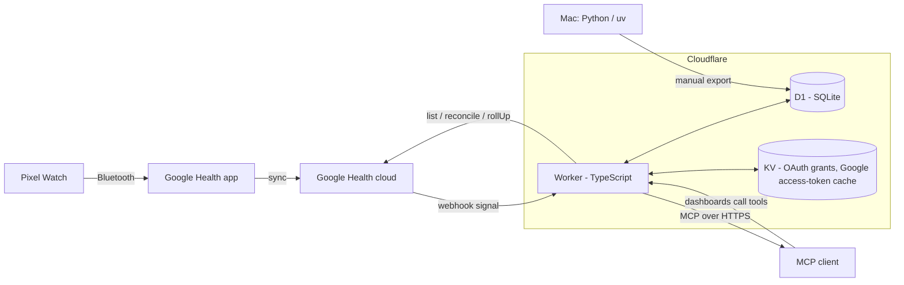

<div align="center">

<picture>
  <source media="(prefers-color-scheme: dark)" srcset="docs/assets/logo-dark.svg">
  
</picture>

# Health Tracker

**Your Pixel Watch data in your own Cloudflare D1 database, queryable from any MCP client, with a live dashboard and one-tap logging, designed for the Cloudflare Free plan.**

[](LICENSE)
[](https://workers.cloudflare.com/)
[](https://www.typescriptlang.org/)
[](https://www.python.org/)

</div>

Health Tracker is a single-user health pipeline. One Cloudflare Worker receives Google Health API change notifications, syncs your Pixel Watch metrics into D1 (SQLite), precomputes daily summaries and serves everything as a remote MCP server behind OAuth 2.1. Connect it to an MCP client such as claude.ai and ask about your sleep, heart rate, HRV and activity, log coffee, cigarettes, alcohol or mood, and run n-of-1 analyses over your own history. It is designed to fit the Cloudflare Workers Free plan.

## Table of contents

- [What works today](#what-works-today)
- [Architecture](#architecture)
- [MCP tools](#mcp-tools)
- [Dashboards](#dashboards)
- [Deploy your own](#deploy-your-own)
- [Data model](#data-model)
- [Privacy & security](#privacy--security)
- [Limits](#limits)
- [What's next](#whats-next)
- [FAQ](#faq)
- [License](#license)

## What works today

| Area | Status on `main` |
|---|---|
| Ingest | Google Health API v4 webhooks (authorization + ECDSA signature verified) queue changes; a 5-minute cron drains them; a daily 48 h reconcile repairs missed notifications and brings in workouts |
| Metrics | Heart rate (per minute), hourly and daily steps (watch only; phone-estimated steps are ignored), resting HR, HRV (RMSSD), SpO2, respiratory rate, skin temperature deviation, active zone minutes, sleep sessions with stages, workouts |
| Sleep | Sessions dated by wake day; short daytime sleep (under 3 h in bed, starting 09:00–19:59 local) is stored as a nap |
| Daily summaries | Recomputed from the earliest changed date through the latest changed date's 28-day score tail (capped at today and 366 dates per batch); z-scores against a 28-day baseline and a heuristic readiness proxy |
| Connector | Remote MCP server (Streamable HTTP), OAuth 2.1 with PKCE, dynamic client registration and client ID metadata documents; Google sign-in limited to one email |
| Trackers | Coffee (caffeine), cigarettes, alcohol and eight mood emotions; safe retries with an idempotency key, undo by soft delete |
| Analytics | Group comparisons with Welch CIs, lagged correlations after AR(1) pre-whitening, weekly/monthly trends, read-only SQL over views |
| Profile | Birth year, sex, height, goals, max HR (measured or estimated) and dated weight history |
| Operations | Watch-sync monitoring with alerts, 90-day audit log retention, manual local export with a verified restore |
| CI | Typecheck, lint and tests for the Worker; ruff and pytest for `py/` |

## Architecture



| Entry point | What it does |
|---|---|
| `POST /webhooks/google` | Checks the authorization header, verifies the ECDSA P-256 signature, queues the interval in `sync_pending`, answers 204 |
| Cron `*/5 * * * *` | Drains at most one queue item per data type (heart rate: up to one hour per tick via 60 s `rollUp`) and upserts into D1; samples the watch's last sync every 30 min; recomputes dirty daily summaries and the last three days of tracker totals. Ticks with an empty queue call Google only for the 30-minute watch sample |
| Cron `30 4 * * *` (UTC) | Queues the 48 h reconcile, deletes expired OAuth states and audit rows older than 90 days |
| `/mcp` | Stateless MCP server behind the OAuth provider (scope `health:read`) |
| `/authorize`, `/oauth/google/callback` | Connector consent and Google sign-in (allowlisted email only) |
| `/google/connect`, `/google/callback` | One-time Google Health consent; stores the encrypted refresh token |
| `GET /watch/today` | Today's sleep, workouts, logs and 15-minute heart rate for the watch face, behind the `WATCH_TOKEN` bearer |
| `POST /watch/log` | One log from the watch (coffee, cigarettes, alcohol or one of the eight moods) with an idempotency key, behind the same bearer |
| `/`, `/privacy`, `/terms`, `/favicon.ico` | Static home, privacy and terms pages (the Google OAuth consent screen links to them) and the brand icon, which MCP clients show next to the connector |

Freshness depends first on how often the watch syncs to the Google Health app (minutes, sometimes hours), then on the 5-minute cron and the queue backlog. Details: [docs/architecture.md](docs/architecture.md).

| Path | Content |
|---|---|
| `worker/` | The Worker (TypeScript, strict), D1 migrations and tests |
| `py/` | Offline tooling (uv, Python 3.12+): manual export and restore check |
| `dashboards/` | HTML dashboards that call the MCP tools |
| `wear/` | Wear OS watch face and its companion app: [docs/watch.md](docs/watch.md) |
| `docs/` | Architecture reference |

## MCP tools

Nineteen tools. Twelve are read-only; seven write (including exploration logs).

| Tool | Access | Returns |
|---|---|---|
| `health_status` | read | Stream freshness, watch last sync, queue counts, Google connection, 14-day HR coverage, alerts |
| `health_daily` | read | Daily summary rows (1–90 days) with units and coverage, including tracker totals and per-mood counts |
| `health_intraday` | read | Heart rate at 1 min (max 3 h window), 5 min or 1 h; steps at 1 h |
| `health_sleep` | read | Sleep sessions, naps and stages (up to 31 days) |
| `health_workouts` | read | Workouts with duration, avg HR, max HR (from minute heart rate), kcal, AZM and distance (up to 31 days) |
| `health_trend` | read | Weekly or monthly aggregates with sample SD and z-score vs the range baseline (1–365 days) |
| `health_compare` | read | Outcome means by behavior group (e.g. caffeine bins vs sleep) with Welch 95% CIs; default lag 1 day (1–365 days) |
| `health_correlate` | read | Lagged correlations after AR(1) pre-whitening; lags 0–7, default up to 3 (1–365 days) |
| `health_trackers` | read | Active trackers, the day's exact totals and up to 50 events |
| `health_profile` | read | Profile, age, goals, measured or estimated max HR, latest 90 dated weights |
| `health_sql` | read | One `SELECT`/`WITH` over `v_daily`, `v_events`, `v_sleep`, `v_workouts`; query up to 4,000 chars; result up to 200 rows and 20,000 chars of row JSON |
| `health_log_event` | insert | Logs one tracker event (time from 7 days ago to 5 minutes ahead, optional note; pass an idempotency key for safe retries) and returns the day total |
| `health_delete_event` | soft delete | Undoes a logged event by its `event.id`; the row is kept with `deleted_at` |
| `health_set_profile` | profile write | Partial profile update; weight is upserted per date (2000-01-01 to local today) |
| `health_scan` | analysis log write | Ranked behavior and planned metric comparisons with confidence labels (default 120 days, max 180) |
| `health_periods` | analysis log write | Streak comparisons, CUSUM changes, mood weeks and anomalies |
| `health_contrast` | analysis log write | Filtered group comparisons; filter dates are clipped to start/end |
| `health_findings` | finding write | List, save, recheck or retire canonical comparisons; confirmation uses new days |
| `health_context` | read | Static playbook, labels, units, ROPEs and physiology priors (≤9,000 characters) |

Notes:

- All tools, including the seven writes, use the single OAuth scope `health:read`.
- Tracker ids: `caffeine` (mg, default 80), `alcohol` (g, default 13), `cigarettes` (count, default 1), and `mood_genial`, `mood_bien`, `mood_tranquilo`, `mood_cansado`, `mood_estresado`, `mood_ansioso`, `mood_triste`, `mood_enfadado` (count, 1 per event; several per day allowed). Daily mood counts are columns of `health_daily` / `v_daily`; individual mood events are in `v_events`.
- `health_compare`, `health_correlate` and `health_trend` accept dates in 2000–2099. Their behaviors are `cigarettes`, `alcohol_g` and `caffeine_mg`; mood columns are not in their allowlists (use `health_sql`). Results are associational, not causal, and include the sample size and a caveat.
- Insight tools (`health_scan`, `health_periods`, `health_contrast`) use separate selections: behaviors `cigarettes`, `caffeine`, `alcohol`, `mood_negative`, `mood_tired`, `workout`, `steps`, `short_sleep`; metrics include sleep, activity, physiology and individual/grouped mood outcomes. Scan also accepts `timings`; filter `metrics`/`timings` to reach planned M1–M8 rows beyond the unfiltered top 10. Acute `hr_delta` rows cover only the last 28 days ending at `end`. `health_context` lists units, timings and interpretation rules.
- `health_profile` defaults to 7000 steps and 450 sleep minutes when goals are unset, and estimates max HR as round(208 − 0.7 × age) when only the birth year is known. Only the birth year is stored, never a full birth date.
- Each executed tool call is audited on a best-effort basis (arguments, outcome, duration); profile tools record field names only. Calls refused by schema validation are not audited.

## Dashboards

The dashboards are self-contained HTML pages that read live data through the MCP connector of the client that hosts them (they are built for claude.ai artifacts and look for a connector named `Health Tracker`).

| File | Content |
|---|---|
| `dashboards/today.html` | Day view: daily metrics, intraday heart rate, sleep stages |
| `dashboards/tracker.html` | Tracker logging and totals |
| `dashboards/trends.html` | Daily metrics over time |

A single-file replacement, **Health Tracker** (`dashboards/health-tracker.html`), is on the `feature/health-tracker` branch and not yet merged:

- Tabs: Today, Sleep, Health, Activity.
- 24-hour day dial with sleep, workouts and logged events.
- One-tap quick log for coffee, cigarette, alcohol and mood, with undo.
- Usual-range strips per metric: p25–p75 band with median; a value is flagged only outside p10–p90.
- Unified day timeline; English and Spanish; phone and desktop layouts; light and dark themes.

## Deploy your own

### Prerequisites

| Requirement | Notes |
|---|---|
| Cloudflare account | `wrangler` logged in; a custom domain for the Worker (`https://<your-domain>`) |
| Node.js and npm | For `worker/` |
| uv and Python 3.12+ | For `py/` |
| Google Cloud project | Google Health API enabled; OAuth client (Web); consent screen External and In production |
| Google Health app | Pixel Watch paired and syncing |
| gcloud CLI | Authenticated; used for the webhook subscriber and secret rotation |

The Health consent requests four read-only scopes: `googlehealth.activity_and_fitness.readonly`, `googlehealth.health_metrics_and_measurements.readonly`, `googlehealth.sleep.readonly` and `googlehealth.settings.readonly`, plus `openid email`.

### 1. Create resources and configure

```sh
cd worker
npm install
npx wrangler d1 create health-tracker
npx wrangler kv namespace create OAUTH_KV
```

Copy `worker/wrangler.production.example.jsonc` to `worker/wrangler.production.jsonc` (git-ignored, so your domain and resource ids stay out of the repo) and set the D1 `database_id`, the KV `id`, the custom-domain route and these `vars`:

| Var | Value |
|---|---|
| `USER_TZ` | Your IANA time zone, e.g. `Europe/Madrid`; local dates and tracker days use it |
| `PUBLIC_ORIGIN` | `https://<your-domain>` |

### 2. Secrets

Set each with `npx wrangler secret put <NAME> --config wrangler.production.jsonc`. Never commit values.

| Name | Purpose |
|---|---|
| `ALLOWED_EMAIL` | The only Google account allowed to sign in; also shown as the contact on `/privacy` and `/terms` |
| `GOOGLE_CLIENT_ID`, `GOOGLE_CLIENT_SECRET` | Google OAuth client (connector sign-in and Health consent) |
| `TOKEN_ENC_KEY` | Base64 of exactly 32 random bytes; AES-256-GCM key for the stored refresh token |
| `WEBHOOK_SECRET` | Webhook authorization value, including the `Bearer ` prefix (at least 16 characters) |
| `WEBHOOK_SECRET_PREV` | Only during a [rotation](#rotating-the-webhook-secret) |
| `WATCH_TOKEN` | Bearer token for the watch app's `/watch/today` and `/watch/log`; it can only log the watch's trackers (at least 32 characters) |

### 3. Migrate and deploy

```sh
npx wrangler d1 migrations apply DB --config wrangler.production.jsonc --remote
npx wrangler deploy --config wrangler.production.jsonc
```

### 4. Google consent and webhook subscriber

1. Add both redirect URIs to the Google OAuth client: `https://<your-domain>/google/callback` and `https://<your-domain>/oauth/google/callback`.
2. Open `https://<your-domain>/google/connect` and grant consent with the allowlisted account.
3. Create a Google Health API webhook subscriber (see the [Google Health API docs](https://developers.google.com/health)) with endpoint `https://<your-domain>/webhooks/google` and endpoint authorization equal to `WEBHOOK_SECRET`. Subscribe to the metric and sleep types; workouts arrive through the daily reconcile. Note the subscriber ID you choose; the rotation commands below read it from `SUBSCRIBER`.
4. Call `health_status` once connected: it shows the Google connection, queue and watch sync.

### 5. Connect an MCP client

| Client | How |
|---|---|
| claude.ai (web, desktop, Android) | Add a custom connector with `https://<your-domain>/mcp` and sign in with the allowlisted Google account. Add it from web or desktop, then use it on Android. Name it `Health Tracker` so the dashboards find it |
| Other MCP clients | Clients supporting remote Streamable HTTP and OAuth 2.1 with PKCE |

An unauthenticated request to `/mcp` returns `401` with a `WWW-Authenticate` header pointing at the protected-resource metadata, which clients use for discovery.

### 6. Dashboards and backups

- Publish a file from `dashboards/` as an artifact in the client where the connector is enabled.
- Backup (run it manually, e.g. weekly; nothing schedules it): `uv run --directory py python src/health_tracker/export.py` from the repo root. It uses your logged-in `wrangler`.

### Development

```sh
(cd worker && npm ci && npm run typecheck && npm run lint && npm test)
(cd py && uv run ruff check . && uv run pytest -q)
```

## Data model

Event, sample and session times are epoch seconds UTC, with `tz_offset_min` on rows that need a local date; daily tables store `local_date` only. Schema: `worker/migrations/0001`–`0010`.

| Table | Content |
|---|---|
| `metric_def` | Metric catalog (unit, aggregation) |
| `metric_minute` | Per-minute heart rate and hourly steps (`steps_h`) |
| `metric_hour` | Hourly table, created but not written yet |
| `metric_daily` | Daily values: steps, resting HR, HRV, SpO2, respiratory rate, skin temperature, AZM |
| `sleep_session`, `sleep_stage` | Sleep sessions (with nap flag) and stages |
| `workout` | Exercise sessions |
| `daily_summary` | One row per day: vitals, sleep, activity, z-scores, readiness proxy (tracker and mood totals are joined in by `v_daily`) |
| `tracker`, `event`, `tracker_daily` | Tracker definitions, logged events (soft-deleted via `deleted_at`), daily totals |
| `profile`, `weight_log` | Owner profile and dated weights; not reachable from `health_sql` |
| `sync_pending`, `sync_state`, `rollup_dirty`, `rollup_seq` | Ingest queue, per-type sync state, dates awaiting recompute |
| `secret_blob`, `oauth_state` | Encrypted Google refresh token, short-lived consent state |
| `audit_log` | Tool and auth audit records, kept 90 days |

Read-only views for `health_sql`: `v_daily`, `v_events` (live events only), `v_sleep`, `v_workouts`.

## Privacy & security

| Topic | Approach |
|---|---|
| Where data lives | Your Cloudflare account: health data, events, sync state and audit log in D1; connector grants and cached Google access tokens in KV (`OAUTH_KV`) |
| Google tokens | Refresh token encrypted with AES-256-GCM in D1; never returned by any tool |
| Webhook | Authorization header compared against SHA-256 digests in constant time before reading the body, then ECDSA P-256 signature verified before parsing. Only exception: an authorized verification handshake of at most 64 bytes containing exactly `{"type":"verification"}` |
| Access | OAuth 2.1 with PKCE; Google sign-in restricted to `ALLOWED_EMAIL`, any other account is refused |
| Tool writes | Insert one event, soft-delete one event, update the profile. No hard deletes, no other writes |
| SQL tool | Lexical and parser guards allow one `SELECT` over the four views and declared CTEs; profile tables are denied |
| Untrusted text | Tracker tools mark event notes as untrusted; `health_sql` sets `notes_untrusted` only when a returned column is named `note` |
| Audit | Executed tool calls and connector sign-in grants/refusals are audited on a best-effort basis; profile audits keep field names only; rows older than 90 days are deleted |
| Backups | D1 Time Travel keeps 7 days on the Free plan at the time of writing ([Cloudflare docs](https://developers.cloudflare.com/d1/reference/time-travel/)). The manual export writes to `~/health-tracker-backups`, verifies a local restore and keeps eight backup pairs. Protect these files as health data |
| Data sent to clients | Tool results go to whichever MCP client you query. Review its retention and training settings, and keep unrelated connectors out of health chats |

This is a personal project, not a medical device, and not medical or legal advice.

**Revoking access.** Remove the app at [Google account permissions](https://myaccount.google.com/permissions); ingestion stops at the next token refresh. Disconnect the connector in each MCP client and delete its grant records from `OAUTH_KV` (`npx wrangler kv key delete --binding OAUTH_KV --remote --config wrangler.production.jsonc <key>`). Already-issued connector access tokens remain valid until they expire. Revocation does not delete stored data or backups.

### Rotating the webhook secret

While `WEBHOOK_SECRET_PREV` is set, both values are accepted. Keep the current value in a password manager and confirm it matches the subscriber before starting. If it is lost, set a fresh value in the Worker and the subscriber together and accept a short gap; the 04:30 UTC reconcile backfills it. Run from `worker/`, one step at a time, with shell tracing off. Do not start another rotation until step 5 is done.

1. Generate the new value and save it as **pending** in the password manager:

   ```sh
   printf 'Bearer '; openssl rand -hex 32
   ```

2. Upload the **current** value as the previous one:

   ```sh
   npx wrangler secret put WEBHOOK_SECRET_PREV --config wrangler.production.jsonc
   ```

3. Upload the **pending** value:

   ```sh
   npx wrangler secret put WEBHOOK_SECRET --config wrangler.production.jsonc
   ```

4. Set `NUM` to your Google Cloud project number, `SUBSCRIBER` to your subscriber ID, and PATCH the subscriber with the pending value (prompted without echo, sent through stdin). On **HTTP 2xx**, make the pending value current in the password manager.

   ```sh
   python3 -c 'import getpass, json; print(json.dumps({"endpointAuthorization": {"secret": getpass.getpass("Pending webhook secret: ")}}))' |
     curl --fail-with-body --request PATCH \
       "https://health.googleapis.com/v4/projects/${NUM}/subscribers/${SUBSCRIBER}?updateMask=endpointAuthorization" \
       --header "Authorization: Bearer $(gcloud auth print-access-token)" \
       --header "x-goog-user-project: ${NUM}" \
       --header 'Content-Type: application/json' \
       --data-binary @- --write-out '\nHTTP %{http_code}\n'
   ```

5. **24 hours after step 4 succeeded**, remove the previous value:

   ```sh
   npx wrangler secret delete WEBHOOK_SECRET_PREV --config wrangler.production.jsonc
   ```

On any failed or uncertain step, stop and retry that same step with the same saved values. Never repeat step 2 after step 3. Never run step 5 before step 4 has succeeded and 24 hours have passed.

## Limits

| Limit | Detail |
|---|---|
| Freshness | Watch sync to the Google Health app, then the 5-minute cron; one queue item per type per tick, an item that fails five times stops retrying until Google is reconnected, while the daily reconcile re-reads the last 48 h |
| Missing metrics | Readiness, Sleep Score and stress are not ingested (not offered by the [Google Health API](https://developers.google.com/health) at the time of writing); `readiness_proxy` is a local heuristic (`0.5·z_ln_rmssd − 0.3·z_rhr + 0.2·z_sleep`) |
| CPU | The Free plan allows 10 ms CPU per invocation at the time of writing ([Cloudflare limits](https://developers.cloudflare.com/workers/platform/limits/)). Cron ticks measured from production logs on one day: p50 ≈ 9 ms, p95 ≈ 17 ms. Watch `exceededCpu` outcomes with `wrangler tail`. Move to Workers Paid if they become frequent |
| Intraday | Heart rate from the Google Health source only; 1-minute reads cover at most 3 hours per call |
| Analysis | Single person, observational data: associations, not causes |
| History | Data starts at Google consent plus what the reconcile window reaches; there is no bulk historical backfill |
| Users | One owner per deployment |

## What's next

No dates; these are ideas, in no particular order.

- Insights on how coffee, cigarettes and alcohol relate to minute-level heart rate and to that night's sleep.
- Merge the Health Tracker dashboard (on its branch today).
- Pixel Watch quick-log tile and watch face.
- macOS menu bar widget.

## FAQ

**Does it need a paid plan?** It is designed for the Cloudflare Workers Free plan and the free tiers of D1 and KV; see [Limits](#limits) for CPU.

**Which MCP clients work?** Clients with remote Streamable HTTP and OAuth 2.1 with PKCE, such as claude.ai, which also hosts the dashboards.

**Can someone else read my data?** Only the allowlisted Google account can complete the connector sign-in. Data is in your Cloudflare account and goes to the MCP clients you connect.

**Can a client delete my data?** No. The only removal is a soft delete of a logged tracker event; health data has no delete tool.

**Why is today's data missing?** Usually the watch has not synced yet; a missing Google connection, failed queue items or a backlog are other causes. `health_status` shows each, and raises `watch_not_syncing` when Google is connected and the last watch sync is missing or more than 24 hours old.

**Does it work with other watches?** It is built for the Pixel Watch through the Google Health API.

## License

Released under the [MIT License](LICENSE).
