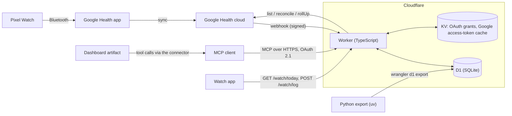

<div align="center">

<picture>
  <source media="(prefers-color-scheme: dark)" srcset="docs/assets/logo-dark.svg">
  
</picture>

# Health Tracker

**Your Pixel Watch data in your own Cloudflare D1 database, queryable from any MCP client, with a live dashboard and one-tap logging from the watch.**

<a href="https://deluispablo.com/healthtracker/"></a>

<picture>
  <source media="(prefers-color-scheme: dark)" srcset="docs/assets/banner/banner-dark.svg">
  
</picture>

[](https://github.com/deluispablo/health-tracker/actions/workflows/ci.yml)
[](LICENSE)
[](https://workers.cloudflare.com/)
[](https://www.typescriptlang.org/)
[](https://www.python.org/)
[](docs/watch.md)

</div>

Health Tracker is a single-owner health pipeline. One Cloudflare Worker receives Google Health API v4 change notifications, syncs your Pixel Watch metrics into D1 (SQLite), precomputes daily summaries and serves everything as a remote MCP server behind OAuth 2.1. From an MCP client you ask about sleep, heart rate, HRV and activity, log coffee, cigarettes, alcohol, water, supplements and mood, and run n-of-1 analyses over your own history. A Pixel Watch face shows today's dial and logs with one tap, and a five-tab dashboard hosted as a claude.ai artifact shows the day, the night and what tends to go with what.

<p align="center"></p>

## Table of contents

- [Features](#features)
- [Architecture](#architecture)
  - [Request and data flows](#request-and-data-flows)
  - [Routes and schedules](#routes-and-schedules)
  - [Repository layout](#repository-layout)
- [Getting started](#getting-started)
  - [1. Prerequisites](#1-prerequisites)
  - [2. Google Cloud, by hand](#2-google-cloud-by-hand)
  - [3. Run the setup](#3-run-the-setup)
  - [4. Connect your MCP client (claude.ai)](#4-connect-your-mcp-client-claudeai)
  - [5. Optional: the watch face](#5-optional-the-watch-face)
  - [6. Optional: the dashboard](#6-optional-the-dashboard)
  - [7. Optional: weekly backups](#7-optional-weekly-backups)
- [MCP tools reference](#mcp-tools-reference)
- [Watch](#watch)
- [Dashboard](#dashboard)
- [Data model](#data-model)
- [Security and privacy](#security-and-privacy)
- [Operations](#operations)
- [Development](#development)
- [Limits and costs](#limits-and-costs)
- [Roadmap](#roadmap)
- [FAQ](#faq)
- [License](#license)

## Features

| Area | What it does |
|---|---|
| Ingest | Google Health API v4 webhooks (authorization header and ECDSA P-256 signature verified) queue changed intervals; a 5-minute cron drains the queue oldest first within a 60 s and 800-statement budget; when Google's watch sync is over 1 h ahead of the stored heart rate, a catch-up pull is queued (at most every 3 h); a daily 48 h reconcile repairs missed notifications, brings in workouts and retries queue items that ran out of attempts; `health_refresh` and the dashboard's refresh button pull the last 24 h on demand |
| Metrics | Per-minute heart rate, hourly and daily steps (watch source only), resting HR, HRV (RMSSD), SpO2, respiratory rate, skin temperature deviation, active zone minutes, sleep sessions with stages, workouts |
| Sleep | Sessions dated by wake day; short daytime sleep (under 3 h in bed, starting 09:00–19:59 local) is stored as a nap |
| Daily summaries | One row per day with vitals, sleep and activity, z-scores against a 28-day baseline and a heuristic readiness proxy; recomputed incrementally from the dates that changed |
| Trackers | Coffee (caffeine), cigarettes, alcohol, water with a daily goal, supplements (melatonin, protein, creatine) and eight mood emotions; idempotent logging and undo by soft delete |
| Analysis | Group comparisons with Welch 95% CIs, lagged correlations after AR(1) pre-whitening, weekly or monthly trends, read-only SQL over four views |
| Insights | Ranked behavior → metric scans with confidence labels, streaks, change points, sustained behavior changes, mood weeks, anomalies, filtered contrasts, and saved findings that are rechecked on new days |
| Connector | Remote MCP server (Streamable HTTP), OAuth 2.1 with PKCE, dynamic client registration and client ID metadata documents; Google sign-in limited to one email |
| Watch | Wear OS face with today's dial, a one-tap log menu (coffee, cigarette, drink, water, mood, supplements) and offline queueing with safe retries |
| Dashboard | Five tabs (Today, Sleep, Health, Activity, Routine) with quick log, usual ranges and insight cards, in English and Spanish, light and dark |
| Profile | Birth year, sex, height, goals, measured or estimated max HR and dated weight history |
| Operations | Health and freshness report with alerts, 90-day retention for audit and analysis logs, local export with a verified restore |

## Architecture



### Request and data flows

1. **Sync.** The watch syncs to the Google Health app, which uploads to the Google Health cloud.
2. **Notify.** Google calls `POST /webhooks/google`. The Worker checks the authorization header, verifies the signature, queues the changed interval in `sync_pending` and answers `204`. Payloads only name intervals; data is always re-read from Google.
3. **Drain.** Every 5 minutes the cron reads the queue oldest first and fetches each interval from the Google Health API (heart rate through 60 s `rollUp`, daily metrics through `listDaily` or `dailyRollUp`, sleep and exercise through `reconcile`). Each item's writes, dirty-date marks and queue removal share one atomic D1 batch, so a failure stores nothing and the item is retried.
4. **Summarize.** The same tick recomputes `daily_summary` from the earliest dirty date through the latest one's 28-day score tail, capped at today and at 366 dates per run.
5. **Reconcile.** At 04:30 UTC the daily cron gives queue items that failed five times a fresh round of five attempts, queues a 48 h re-read of every type, rebuilds the last eight days of tracker totals and deletes expired OAuth states and audit and analysis-log rows older than 90 days.
6. **Query.** MCP clients call `health_*` tools on `/mcp`. Tools read and write D1 only, except `health_refresh`, which pulls the last 24 h from Google on demand.
7. **Log.** Tracker events arrive from `health_log_event` or the watch's `POST /watch/log`; both insert the event and rebuild that day's `tracker_daily` row in one batch.

Freshness depends first on how often the watch syncs to the Google Health app (minutes, sometimes hours), then on the 5-minute cron and the queue backlog.

Ingest heals itself when a webhook is missed. Every 30 minutes the cron reads the watch's last sync time from Google; when it is over 1 h ahead of the newest stored heart-rate minute, the cron queues a catch-up pull of every type from that minute (at most 48 h back), at most once every 3 h. The daily reconcile covers the rest, and `health_refresh` (or the dashboard's refresh button) pulls the last 24 h at once.

### Routes and schedules

| Entry point | Auth | What it does |
|---|---|---|
| `POST /webhooks/google` | `WEBHOOK_SECRET` header and Google signature | Queues changed intervals; a bounded `{"type":"verification"}` handshake returns `200` |
| `*/5 * * * *` cron | n/a | Drains the queue (at most one heart-rate item older than 24 h per tick, each covering up to one day), samples the watch's last sync every 30 min and queues a catch-up pull when it is over 1 h ahead of the stored heart rate (at most every 3 h), recomputes dirty daily summaries. With an empty queue, Google is called only for the 30-minute watch sample |
| `30 4 * * *` cron (UTC) | n/a | Resets queue items that failed five times, queues the 48 h reconcile, rebuilds eight days of tracker totals, applies retention |
| `/mcp` | OAuth bearer, scope `health:read` | Stateless Streamable HTTP MCP server with 20 tools |
| `/authorize`, `/oauth/token`, `/oauth/register` | n/a | OAuth 2.1 provider: consent, token and dynamic client registration, plus its `/.well-known/` metadata |
| `/oauth/google/callback` | Google sign-in | Completes connector sign-in; only `ALLOWED_EMAIL` is accepted |
| `GET /google/connect`, `GET /google/callback` | Google sign-in | One-time Google Health consent; stores the encrypted refresh token for `ALLOWED_EMAIL` only |
| `GET /watch/today` | `WATCH_TOKEN` bearer | Today's sleep, workouts, logs, water, tracker catalog and 15-minute heart rate for the watch |
| `POST /watch/log`, `DELETE /watch/log` | `WATCH_TOKEN` bearer | Logs or undoes one watch tap by idempotency key |
| `/`, `/privacy`, `/terms`, `/favicon.ico` | public | Static home, privacy and terms pages (in Spanish, linked from the Google consent screen) and the icon MCP clients show |

The deep reference for ingest, rollups, the Google client and each tool is [docs/architecture.md](docs/architecture.md).

### Repository layout

| Path | Content |
|---|---|
| `worker/src/index.ts` | Entry point; wraps the app in the OAuth provider |
| `worker/src/app.ts` | HTTP routing and both cron handlers |
| `worker/src/auth/` | Google Health consent and connector sign-in |
| `worker/src/ingest/` | Webhook, queue drain and daily reconcile |
| `worker/src/google/` | Google Health API client with token cache and retries |
| `worker/src/rollup/` | Daily summary and tracker totals |
| `worker/src/mcp/` | MCP server and the 20 tools (`tools/insights/` holds the insight engine) |
| `worker/src/watch.ts` | Watch endpoints |
| `worker/migrations/` | D1 schema, `0001`–`0015` |
| `worker/test/` | Vitest suites running in the Workers runtime |
| `py/` | Weekly backup export with restore check (uv, Python 3.12+) |
| `wear/` | Wear OS companion app (`app`) and Watch Face Format face (`watchface`) |
| `dashboards/` | Dashboard shell `health-tracker.html` and tab modules `tabs/*.js` |
| `landing/` | Product landing page: a static `index.html` plus dashboard screenshots with sample data in `img/`, published at [deluispablo.com/healthtracker](https://deluispablo.com/healthtracker/) |
| `docs/` | [Architecture](docs/architecture.md), [watch](docs/watch.md), [operations](docs/operations.md) and brand assets |

## Getting started

This guide installs your own copy. You paste commands into a terminal; you do not need to write code. Plan for about 30 minutes. Each deployment serves one owner.

Steps 1 to 4 are required. Steps 5, 6 and 7 (the watch face, the dashboard and weekly backups) are **optional**: skip them and everything else still works.

Wherever you see `<your-domain>`, type the domain you will use, for example `health.example.com`.

### 1. Prerequisites

| You need | Needed for | Notes |
|---|---|---|
| A Cloudflare account on the Workers Paid plan, with a domain added to it | Required | The Worker will live at `https://<your-domain>` |
| A Google Cloud project | Required | A free project is enough; create it at [console.cloud.google.com](https://console.cloud.google.com/) |
| [Git](https://git-scm.com/downloads) | Required | To download the code; check with `git --version` |
| [Node.js](https://nodejs.org/) 22 or newer (the LTS version) | Required | Check with `node --version` |
| The [gcloud CLI](https://cloud.google.com/sdk/docs/install) | Required | Then run `gcloud auth login` once |
| A Pixel Watch paired with the Google Health app | Required | It is the data source |
| JDK 17 and the Android SDK (platform 36, build-tools 36.0.0) | Watch face only | See [docs/watch.md](docs/watch.md) |
| [uv](https://docs.astral.sh/uv/) | Backups only | |

Download the code once:

```sh
git clone https://github.com/deluispablo/health-tracker.git
cd health-tracker
```

### 2. Google Cloud, by hand

Google does not let a script do this part, so do it in the [Google Cloud console](https://console.cloud.google.com/) with your project selected.

1. **Enable the Google Health API.** Open APIs & Services, then Library, search for "Google Health API" and press **Enable**.
2. **Set up the consent screen.** Open the menu, then **Google Auth Platform**. If it says it is not configured yet, press **Get started**.
   - Under **Branding**: App name `Health Tracker`; where Google asks for a support or developer email, use yours. Then set:
     - App home page: `https://<your-domain>/`
     - Privacy policy link: `https://<your-domain>/privacy`
     - Terms of service link: `https://<your-domain>/terms`
     - Authorized domain: `<your-domain>` (if Google wants the main domain only, use that).
   - Under **Audience**: User type **External**, then press **Publish app** so the status reads **In production**. In Testing, Google signs you out every 7 days.
3. **Create the OAuth client.** Under **Google Auth Platform**, open **Clients**, then **Create client**.
   - Application type: **Web application**. Name: `Health Tracker`.
   - Under **Authorized redirect URIs** add both of these:
     - `https://<your-domain>/google/callback`
     - `https://<your-domain>/oauth/google/callback`
   - Press **Create**.
4. Copy the **client ID** and the **client secret** from the window that opens. You paste them in step 3.

If a page looks different, Google has moved a menu; search the console for the page name.

### 3. Run the setup

From the folder you downloaded, install the script's tools once:

```sh
cd worker && npm ci
```

Then try a practice run first. It asks the same questions but changes nothing:

```sh
npm run setup -- --dry-run
```

When it looks right, run the real thing:

```sh
npm run setup
```

You do not need to deploy anything beforehand. The script prints a heading for each step (`== tools`, `== ask`, and so on) and a line for what it does. If it was stopped, run it again: it reuses what it already created, skips the finished steps and continues where it stopped. It always runs the database update and the deploy again, which is harmless.

The practice run (`--dry-run`) asks the same questions except the Google client secret: wrangler asks for that only in the real run.

**The questions, in order:**

1. Your domain, for example `health.example.com` (no `https://`).
2. Your Google email.
3. The Google OAuth client ID from step 2.
4. It shows what you typed and what it is about to create, and asks `Continue with these values? [y/N]`. Type `y` and press Enter.
5. Only if your Cloudflare login has several accounts: which account to use (type its number).
6. `Use Google Cloud project <id>? [y/N]`, using the project gcloud has selected. Type `y`, or `n` and then type your Google Cloud project ID (the project ID is shown at the top of the Google Cloud console).
7. Later, **wrangler** (Cloudflare's own tool) asks for your Google client secret. Paste it there and press Enter. Nothing shows on screen while you type; that is normal. The setup script never sees the secret and never saves it.

Your domain, email, client ID, Cloudflare account and project ID are saved in `worker/setup.local.json`, a file that is not uploaded to Git. On a re-run it shows them and asks `Use these saved values and continue? [y/N]`.

**The steps:**

| Step | What you see |
|---|---|
| `tools` | Checks Node.js (version 22 or newer), Cloudflare and gcloud. If Cloudflare is not logged in, it opens the login in your browser. If gcloud is not logged in, it stops and tells you to run `gcloud auth login`. |
| `ask` | The questions above. |
| `resources` | Creates the database and the storage in your Cloudflare account (or reuses ones that already exist) and writes `worker/wrangler.production.jsonc`. |
| `secrets` | Stores your email, client ID and client secret, plus a key it generates, in Cloudflare. |
| `deploy` | Updates the database and deploys the Worker, then waits until `https://<your-domain>/` answers. A new domain can take a few minutes to get its certificate; if the wait runs out, run the setup again. |
| `connect` | Opens `https://<your-domain>/google/connect` in your browser. Sign in with your Google email and allow every permission. The script waits up to 10 minutes. |
| `subscriber` | Tells Google where to send new health data, with a secret it generates and stores. |
| `verify` | Checks that Google is connected and nothing is stuck. |

At the end you see:

```
All set. Add this MCP connector URL in your client: https://<your-domain>/mcp
```

It never deletes anything.

**If a step fails,** the script says in plain words what went wrong and what to do, and stops. Fix that, then run `npm run setup` again.

### 4. Connect your MCP client (claude.ai)

1. Open claude.ai in a browser (or the desktop app) and go to Settings, then Connectors.
2. Add a custom connector. Name: `Health Tracker` (use exactly this name; the dashboard looks for it). URL: the address the script printed, `https://<your-domain>/mcp`.
3. Sign in with the same Google email.
4. In a new chat, ask "call health_status". It should show the Google connection as connected.

Data appears after the watch next syncs to the Google Health app, from a few minutes to an hour. History starts from now plus the last 48 hours; older data is not imported. If nothing shows up, see [Troubleshooting](#troubleshooting).

Add the connector from the web or desktop app first; it then works on Android too. Other assistants that support remote MCP servers with OAuth 2.1 also work.

### 5. Optional: the watch face

Skip this if you only want your data in the assistant. You need a Pixel Watch (Wear OS 6 or later), JDK 17, the Android SDK and about 20 more minutes.

1. From `worker/`, run the setup with the watch option:

   ```sh
   npm run setup -- --watch
   ```

   It runs the same steps as step 3 (finished ones are skipped; the database update and deploy run again, which is harmless) and also stores a watch token in Cloudflare and writes `wear/local.properties` with the token, your address and the Android SDK path. It finds the SDK from `ANDROID_HOME`, from `ANDROID_SDK_ROOT`, or from a `sdk.dir` line already in `wear/local.properties`. If none is available it stops at the start and tells you so; set it (`export ANDROID_HOME=<your-android-sdk-folder>`) and run it again. Running it again keeps the same token.
2. Pair the watch with your computer over wireless debugging, then build and install:

   ```sh
   cd ../wear
   ./gradlew :app:installDebug :watchface:installDebug
   adb shell am broadcast -a com.google.android.wearable.app.DEBUG_SURFACE \
     --es operation set-watchface --es watchFaceId com.deluispablo.healthtracker.watchface
   ```

Pairing steps and troubleshooting are in [docs/watch.md](docs/watch.md).

### 6. Optional: the dashboard

Skip this if you do not need the five-tab page. It runs inside claude.ai and reads your data through the connector. It needs a paid claude.ai plan with code execution and file creation turned on, so that artifacts can use connectors.

1. Open this folder in the claude.ai desktop app's code workspace, with the `Health Tracker` connector turned on.
2. Ask it: "Publish `dashboards/health-tracker.html` as an artifact, with the five files in `dashboards/tabs/` as supporting files under `tabs/`." The page loads them by those relative names, so they must be published together with it.
3. Open the artifact and allow it to use the connector's tools once.

### 7. Optional: weekly backups

Skip this if Cloudflare's own 30-day history is enough for you. Install [uv](https://docs.astral.sh/uv/), then from `worker/`:

```sh
npm run backup:schedule
```

On a Mac it installs and loads a weekly job (a LaunchAgent, Sunday at 10:00) and prints where the log is. On Linux it prints one line for you to add yourself with `crontab -e`; paste it there and save. Either way, copies go to `~/health-tracker-backups` and the log is `backup.log` in that folder. If the script says it cannot find `uv`, `node` or `npx`, install it and run the command again. Each backup holds all your health data, so keep that folder private.

### More detail

Every var, secret, config field, the webhook subscriber and the manual version of each setup step are in [docs/setup-reference.md](docs/setup-reference.md). Day-to-day tasks (logs, rotating secrets, backups, revoking access) are in [docs/operations.md](docs/operations.md).

## MCP tools reference

Twenty tools. All use the single OAuth scope `health:read`, including the writes. Dates are local `YYYY-MM-DD` in the owner's current zone (automatic from the watch, `USER_TZ` as fallback), and ranges are inclusive.

| Tool | Access | Returns | Input limits |
|---|---|---|---|
| `health_status` | read | Stream freshness, watch last sync, queue counts, Google connection, 14-day HR coverage, alerts | none |
| `health_refresh` | write | Pulls the last 24 h of every type from Google, drains what fits in about 20 s and recomputes summaries; returns processed, failed and pending items and the newest stored heart-rate minute | No arguments; at most once per 120 s, otherwise `throttled` with `retry_after_s` |
| `health_daily` | read | Daily summary rows with units and coverage, including cigarette, alcohol, caffeine and per-mood totals | 1–90 dates; optional metric list |
| `health_intraday` | read | Heart rate avg/min/max at `1m`, `5m` or `1h`; steps at `1h` | One date in 2000–2099; optional `from`/`to` (`HH:MM`); at most 150 points and 20,000 JSON characters, with a `truncated` flag |
| `health_sleep` | read | Sleep sessions, naps and stages | 1–31 dates |
| `health_workouts` | read | Workouts with duration, average and max HR (from minute heart rate), kcal, AZM and distance | 1–31 dates |
| `health_trackers` | read | Active trackers with units, defaults and limits, the day's exact totals and up to 50 events | One date |
| `health_profile` | read | Profile, age, goals, measured or estimated max HR, latest 90 dated weights | none |
| `health_trend` | read | Weekly or monthly aggregates with sample SD and z-score against the range baseline | 1–365 dates in 2000–2099 |
| `health_compare` | read | Outcome means by behavior group with Welch 95% CIs | 1–365 dates; lag 0–7 (default 1); 1–5 bins |
| `health_correlate` | read | Lagged Pearson r after AR(1) pre-whitening | 1–365 dates; `max_lag` 0–7 (default 3) |
| `health_sql` | read | One `SELECT` or `WITH` over `v_daily`, `v_events`, `v_sleep`, `v_workouts` | Query up to 4,000 characters; result up to 200 rows, 800 cells and 20,000 characters of row JSON |
| `health_context` | read | Static playbook, labels, units, ROPEs and physiology priors | none; output up to 9,000 characters |
| `health_log_event` | insert | One tracker event and the day's total | `at` from 7 days ago to 5 minutes ahead; note up to 280 code points; idempotency key of 8–64 `[A-Za-z0-9_-]` |
| `health_delete_event` | soft delete | Undoes an event by its `event.id`; the row keeps `deleted_at` | `event_id` of 1–80 characters |
| `health_set_profile` | profile write | Partial profile update; weight upserted per date | See [profile fields](#profile-fields) |
| `health_scan` | analysis log write | Ranked behavior and planned metric comparisons with confidence labels | Up to 180 days (default 120); `limit` 1–10 |
| `health_periods` | analysis log write | Streaks, CUSUM changes, sustained behavior changes, mood weeks and anomalies | Up to 180 days (default 120) |
| `health_contrast` | analysis log write | Two filtered groups compared; filter dates are clipped to the range | Up to 180 days; up to 4 AND conditions per group |
| `health_findings` | finding write | `list` (up to 20), `save`, `recheck` or `retire` saved comparisons; confirmation uses only days after saving | Statement of 1–500 code points |

### Tracker catalog

| Id | Unit | Type | Default | Limits | On the watch |
|---|---|---|---|---|---|
| `caffeine` | mg | amount | 80 | 1–1000 | menu button |
| `cigarettes` | u | count | 1 | 1–20 | menu button |
| `alcohol` | g | amount | 13 | 1–200 | menu button |
| `water` | ml | amount | 250 | 50–2000 | menu button |
| `melatonin` | mg | amount | 1 | 0.1–10 | supplements ring |
| `protein` | g | amount | 30 | 5–100 | supplements ring |
| `creatine` | g | amount | 5 | 1–20 | supplements ring |
| `mood_genial`, `mood_bien`, `mood_tranquilo`, `mood_cansado`, `mood_estresado`, `mood_ansioso`, `mood_triste`, `mood_enfadado` | u | count | 1 | 1–1 | mood ring |

The table shows the seeded values; `health_trackers` returns the current ones. Several moods per day are allowed. Daily mood counts are columns of `health_daily` and `v_daily`; individual events are in `v_events`.

### Analysis and insight inputs

- `health_compare` behaviors: `cigarettes`, `alcohol_g`, `caffeine_mg` (default bins `[5, 10]`, `[20, 40]`, `[200, 400]`). Outcomes: `rhr`, `hrv_rmssd`, `ln_rmssd`, `resp_rate`, `spo2_avg`, `skin_temp_dev`, `sleep_min`, `sleep_eff`, `deep_min`, `rem_min`, `sleep_latency_min`, `steps`, `azm`, `readiness_proxy`. Behavior on day D pairs with the outcome on D + lag, so the default lag of 1 matches sleep's wake date.
- Insight behaviors (`health_scan`, `health_periods`, `health_contrast`): `cigarettes`, `caffeine`, `alcohol`, `water`, `melatonin`, `protein`, `creatine`, `mood_negative`, `mood_tired`, `workout`, `steps`, `short_sleep`. Metrics cover sleep, activity, physiology and individual or grouped mood outcomes. Behavior days run from 05:00 to 05:00 local. `health_context` lists every id, timing, unit and rule.
- Confidence labels are returned in Spanish: `sólido`, `probable`, `indicio`, `sin_diferencia`, `sin_datos`, `cambio`. Results are associational, not causal, and include sample sizes.

### Profile fields

| Field | Accepted |
|---|---|
| `birth_year` | Integer from 1920 to the current local year; only the year is stored |
| `sex` | `female`, `male` or `null` to clear |
| `height_cm`, `weight_kg` | 100–250 cm and 30–300 kg, rounded to 0.1 |
| `date` | Weight date from 2000-01-01 to local today; defaults to today |
| `step_goal`, `sleep_goal_min`, `water_goal_ml` | Integers in 1000–50000, 240–720 and 500–6000; unset goals read as 7000, 450 and 2000 |
| `max_hr` | Measured, integer in 120–230; otherwise estimated as round(208 − 0.7 × age) |
| `smoker` | Boolean |

Each executed tool call is audited on a best-effort basis (arguments, outcome, duration); profile tools record field names only. Calls refused by schema validation are not audited.

## Watch

The `wear/` project has two modules, sideloaded with ADB:

| Module | What it is |
|---|---|
| `app` | Companion app: fetches `GET /watch/today` hourly, renders the dial to an image, serves it as a complication and hosts the log menu |
| `watchface` | Resource-only Watch Face Format v4 face: bezel, 24-hour and minute hands, the dial image and four editable edge complications |

- **Requirements:** Wear OS 6 or later. Built for a 41 mm Pixel Watch 3; other round watches should work.
- **Dial:** today's sleep, workouts, logs and 15-minute heart rate on a 24-hour ring. It fades when the data is more than three hours old.
- **Log menu:** tap the centre of the face for six buttons. Coffee, cigarette, drink and water log with one tap; mood and supplements open a ring of choices. Water shows progress towards `water_goal_ml`.
- **Offline and safe retries:** each tap is queued on the watch with a random idempotency key and sent to `POST /watch/log` when online. An undo button takes back the last watch log for 15 minutes.
- **Token scope:** `WATCH_TOKEN` can read today's dial data and log or undo only trackers in the watch catalog. Watch logs use their own id prefix, so the token cannot replay or undo a log made through MCP.

The build, pairing, endpoint contract, troubleshooting and preview-image procedure are in [docs/watch.md](docs/watch.md).

## Dashboard

The dashboard reads live data through the MCP connector of the client that hosts it. `dashboards/health-tracker.html` is the shell (header, quick log, shared charts, insight cards, copy and theme), and each tab is a module in `dashboards/tabs/` that registers itself with `HT.registerTab`.

| Tab | File | What it shows |
|---|---|---|
| Today | `tabs/hoy.js` | The 24-hour dial with sleep, workouts, logs and heart rate; recovery and vitals; steps against the goal; the day's totals and timeline |
| Sleep | `tabs/sueno.js` | The night with its hypnogram and logs before bed, stages against your usual range, recent nights, sleep by weekday and what may have played a part |
| Health | `tabs/salud.js` | Last night's vitals against your usual range, 30- and 90-day trends, today's heart rate and its response around each log, and saved findings |
| Activity | `tabs/actividad.js` | Steps today and by hour, your usual day, the 30-day trend, active minutes per week, workouts and what changes your activity |
| Routine | `tabs/rutina.js` | Your days hour by hour, first times of the day, what leads to what, water, supplements and mood |

- **Quick log:** one tap for coffee, cigarette, alcohol and water; mood and supplements open a picker. Every log can be undone, and taps are sent in order with a retry.
- **Usual ranges:** strips show the p25–p75 band and median over the previous 28 days; a value is flagged only outside p10–p90. With few days of data a card says so.
- **Insights:** cards built on `health_periods`, `health_scan` and `health_findings` say what goes with what and how sure the comparison is, without claiming causes.
- **Sync chip and refresh:** the header shows how fresh the data is ("Datos hasta HH:MM", or "Data up to HH:MM" in English), from the newest stored heart-rate minute. It is marked stale on a `data_lag` alert, a watch sync over 3 h old or heart rate over 24 h old. The refresh button calls `health_refresh` and reloads the open tabs; within 120 s of the last refresh it says how long to wait.
- **Layout:** English and Spanish; light, dark and automatic themes; phone, tablet and desktop; keyboard and screen-reader support.
- **Tools used:** the page declares 14 tools in its `mcp-manifest` block: the read tools except `health_trend`, `health_compare`, `health_correlate` and `health_context`, plus `health_log_event`, `health_delete_event`, `health_scan`, `health_periods`, `health_findings` and `health_refresh`.

Nights are named by the evening they start ("night of Thu 22" ends on Friday morning). Until tonight's sleep syncs, Sleep and Today show the previous night and say so.

## Data model

Event, sample and session times are epoch seconds UTC, with `tz_offset_min` on rows that need a local date; daily tables store `local_date`. Schema: [`worker/migrations/`](worker/migrations), `0001`–`0015`.

| Table | Content |
|---|---|
| `metric_def` | Metric catalog (unit, aggregation) |
| `metric_minute` | Per-minute heart rate and hourly steps (`steps_h`) |
| `metric_hour` | Hourly table, created but not written |
| `metric_daily` | Daily values: steps, resting HR, HRV, SpO2, respiratory rate, skin temperature, AZM |
| `sleep_session`, `sleep_stage` | Sleep sessions (with nap flag) and stages |
| `workout` | Exercise sessions |
| `daily_summary` | One row per day: vitals, sleep, activity, z-scores, readiness proxy |
| `tracker`, `event`, `tracker_daily` | Tracker catalog (default, limits, watch surface, order, archive date), events (soft-deleted via `deleted_at`) and daily totals |
| `finding`, `finding_check`, `analysis_log` | Saved findings, their rechecks, and the log of exploration runs (kept 90 days) |
| `profile`, `weight_log` | Owner profile and dated weights; not reachable from `health_sql` |
| `sync_pending`, `sync_state` | Ingest queue and per-type sync state, including the watch's last sync |
| `rollup_dirty`, `rollup_seq` | Dates awaiting summary recompute and their version sequence |
| `secret_blob`, `oauth_state` | Encrypted Google refresh token and 10-minute consent state |
| `audit_log` | Tool and sign-in audit records, kept 90 days |

Read-only views for `health_sql`: `v_daily` (summary plus tracker and mood totals), `v_events` (live events only), `v_sleep` and `v_workouts`.

## Security and privacy

### Threat model

| Entry point or asset | Threat | Mitigation |
|---|---|---|
| `/mcp` | Someone else connects a client | OAuth 2.1 with PKCE; Google sign-in must return a verified `ALLOWED_EMAIL`; other accounts are refused and audited |
| Connector tokens | A client token leaks | The OAuth provider owns token lifetimes and refresh rotation; grants can be deleted from `OAUTH_KV`. No tool hard-deletes data |
| Webhook | Forged or replayed notifications | Header compared as SHA-256 digests in constant time before the body is read, then ECDSA P-256 signature verified before parsing. Payloads only name intervals; data is always re-read from Google |
| Google refresh token | Theft from D1 or a backup | Encrypted with AES-256-GCM under `TOKEN_ENC_KEY`, which exists only as a Worker secret; never returned by any tool or logged |
| `WATCH_TOKEN` | Extracted from the watch build | Can read today's dial and log or undo watch-catalog trackers only; compared in constant time; rotate by resetting the secret and rebuilding the app |
| `health_sql` | Injection or exfiltration | Lexical and parser guards allow one `SELECT` over four views and declared CTEs; profile tables are denied; output is capped |
| Event notes | Prompt injection through stored text | Notes are returned marked as untrusted; `health_sql` sets `notes_untrusted` when a returned column is named `note` |
| `/google/connect` | Anyone can start consent | Only a verified `ALLOWED_EMAIL` identity can store a token; state is single-use and expires in 10 minutes |

Out of scope: a compromised Cloudflare or Google account, and the retention policies of the MCP clients you connect.

### Privacy

| Topic | Approach |
|---|---|
| Where data lives | Your Cloudflare account: health data, events, sync state and audit log in D1; connector grants and the cached Google access token in KV |
| Tool writes | Insert one event, soft-delete one event, update the profile, save or retire findings, and append analysis logs. Health data has no delete tool |
| Audit | Executed tool calls and sign-in grants and refusals, best effort; profile audits keep field names only; 90-day retention |
| Backups | D1 Time Travel keeps 30 days on Workers Paid at the time of writing ([Cloudflare docs](https://developers.cloudflare.com/d1/reference/time-travel/)). Local exports contain every table, including the encrypted token; protect them as health data |
| Data sent to clients | Tool results go to whichever MCP client you query. Review its retention and training settings, and keep unrelated connectors out of health chats |

This is a personal project, not a medical device, and not medical advice.

## Operations

| Task | How |
|---|---|
| Check health | Call `health_status`; see the alerts below |
| Data not arriving | Sync the phone, then press refresh or call `health_refresh`: [docs/operations.md](docs/operations.md#data-not-arriving) |
| Read logs | `npx wrangler tail --config wrangler.production.jsonc`; Workers observability is enabled in the config |
| Back up weekly | Run the export from cron or launchd, or from a scheduled job that also compares row counts: [docs/operations.md](docs/operations.md#back-up-weekly) |
| Rotate the webhook secret | 24-hour overlap through `WEBHOOK_SECRET_PREV`: [docs/operations.md](docs/operations.md#rotate-the-webhook-secret) |
| Rotate the watch token | Set a new `WATCH_TOKEN`, update `watchToken` in `wear/local.properties`, rebuild and reinstall the app |
| Revoke access | [docs/operations.md](docs/operations.md#revoke-access) |

`health_status` alerts (messages are in Spanish):

| Code | Raised when |
|---|---|
| `google_disconnected` | No Google refresh token is stored |
| `no_data_48h` | No heart rate in the last 48 hours |
| `no_sleep_48h` | Google is connected and no main sleep ended in the last 48 hours |
| `queue_stuck` | Queue items have failed five times; the 04:30 UTC run gives them another round |
| `daily_stale` | The latest daily summary is older than yesterday |
| `watch_not_syncing` | Google is connected and the watch's last sync is missing or more than 24 hours old |
| `data_lag` | Google's last watch sync is more than 3 hours ahead of the newest stored heart-rate minute |
| `hr_coverage_gap` | Three or more consecutive past days have at most one heart-rate minute |

### Troubleshooting

| Symptom | Likely cause | Fix |
|---|---|---|
| Today's data is missing | The watch has not synced to the Google Health app | Open the Google Health app on the phone, then press refresh in the dashboard or call `health_refresh`; check `watch_not_syncing` and `data_lag` |
| `google_disconnected` | No stored refresh token | Open `https://<your-domain>/google/connect` |
| `queue_stuck` | Items failed five times, often during a Google outage or after Google access expired or was revoked | Wait for the 04:30 UTC run, which retries them; if Google access was lost, reconnect through `/google/connect`, which resets their attempts at once |
| `data_lag` | A webhook was missed or the queue is behind | The cron usually queues a catch-up pull within 30 minutes; at most one automatic pull every 3 hours. Press refresh or call `health_refresh` to pull now |
| `daily_stale` | The cron is not running or fails | Check `wrangler tail` and that both cron triggers are deployed |
| Webhooks return `503` | `WEBHOOK_SECRET` is unset or shorter than 16 characters, or Google's public keyset is unreachable | Set the secret; the keyset is fetched again on the next call |
| `400 Missing scopes` on consent | A scope was unticked on the consent screen | Repeat `/google/connect` and grant all four |
| The watch dial never appears | `watchToken` does not match `WATCH_TOKEN` (`401`) | Fix `wear/local.properties` and rebuild; more in [docs/watch.md](docs/watch.md#troubleshooting) |
| The dashboard asks to turn on the connector | The connector is not named `Health Tracker` or is off | Rename or enable it in the client's connector settings and reopen the page |

## Development

```sh
# Worker
cd worker
npm ci
npm run typecheck   # tsc --noEmit, strict
npm run lint        # eslint
npm test            # vitest in the Workers runtime, then the CPU-budget suites serially

# Python
cd py
uv run ruff check .
uv run pytest -q

# Watch unit tests (need wear/local.properties)
cd wear
./gradlew :app:testDebugUnitTest
```

| Topic | Convention |
|---|---|
| CI | [`.github/workflows/ci.yml`](.github/workflows/ci.yml) runs typecheck, lint and tests for `worker/`, and ruff and pytest for `py/`, on every push to `main` |
| Commits | [Conventional Commits](https://www.conventionalcommits.org/), for example `feat(dashboard): …`, `fix(ingest): …`, `docs: …` |
| Schema changes | A new numbered file in `worker/migrations/`; tests apply every migration to a local D1 |
| Tests | `@cloudflare/vitest-plugin` runs suites in the Workers runtime against `wrangler.jsonc`; network calls are injected |
| Python style | ruff with Google-style docstrings, line length 100 |
| Watch face | Edit `wear/watchface/generate.py`, not the generated XML |
| Local config | `worker/wrangler.production.jsonc` and `wear/local.properties` are git-ignored |

## Limits and costs

| Limit | Detail |
|---|---|
| Plan | Workers Paid ([pricing](https://developers.cloudflare.com/workers/platform/pricing/)). The Free plan's 10 ms CPU and 50 D1 queries per invocation are too tight ([limits](https://developers.cloudflare.com/workers/platform/limits/)) |
| Measured CPU | Over one hour in production: MCP calls p50 166 ms (mostly cold starts; 3–27 ms warm), cron ticks p50 20 ms |
| D1 and KV | Within the plan's included usage for one person |
| Freshness | Watch sync, then the 5-minute cron with its 60 s budget; historical heart rate drains one day per tick |
| Retries | An item that fails five times waits for the 04:30 UTC run, which gives it five more attempts, or for a Google reconnect; the daily reconcile re-reads the last 48 h |
| Missing metrics | Readiness, Sleep Score and stress are not offered by the Google Health API at the time of writing; `readiness_proxy` is a local heuristic (`0.5·z_ln_rmssd − 0.3·z_rhr + 0.2·z_sleep`) |
| History | Starts at consent plus the reconcile window; no bulk backfill |
| Analysis | Single person, observational data: associations, not causes |
| Users | One owner per deployment |

## Roadmap

- A public landing page that lets anyone see the product.

## FAQ

**Does it need a paid plan?** Yes, Cloudflare Workers Paid. See [Limits and costs](#limits-and-costs).

**Which MCP clients work?** Clients with remote Streamable HTTP and OAuth 2.1 with PKCE, such as claude.ai, which also hosts the dashboard.

**Can someone else read my data?** Only the allowlisted Google account can complete the connector sign-in. Data stays in your Cloudflare account and goes to the MCP clients you connect.

**Can a client delete my data?** No. The only removal is a soft delete of a logged tracker event; health data has no delete tool.

**Why is today's data missing?** Usually the watch has not synced yet. `health_status` shows the Google connection, failed queue items and the watch's last sync. After the phone syncs, press refresh in the dashboard or call `health_refresh`.

**Does it work with other watches?** Data comes from the Pixel Watch through the Google Health API. The watch face needs Wear OS 6 on a round watch.

**Can I use another time zone?** It is automatic: the watch reports its zone on every sync and the Worker, the dashboard and the watch follow it, within about an hour of a change (the watch sends it in the `X-Time-Zone` header of `GET /watch/today` and of `POST`/`DELETE /watch/log`, including undo). Days already stored keep the zone they were lived in, and acute insights use the stored heart-rate offsets. The night band is drawn only for Europe/Madrid and the Australian zones Sydney, Melbourne, Brisbane, Perth, Adelaide, Hobart and Darwin. Travel-day limits: a tap queued offline before a zone change is dated in the zone current when it is sent, and a re-pull of data from before the change (the 48-hour reconcile, a manual backfill) can move those minutes' dates. `USER_TZ` (`Europe/Madrid` by default) is only the fallback.

## License

Released under the [MIT License](LICENSE). Third-party notices for the watch are in [wear/THIRD_PARTY_NOTICES.md](wear/THIRD_PARTY_NOTICES.md).
