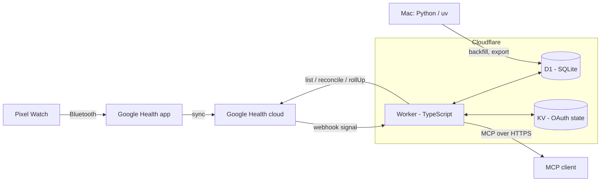

<div align="center">

# Pixel Health

**Your Pixel Watch data in your own database, queryable from any MCP client, at zero cost.**

[](LICENSE)
[](https://workers.cloudflare.com/)
[](https://www.typescriptlang.org/)
[](https://www.python.org/)

</div>

> **Status: early development.** This README describes the target design and the roadmap. Nothing below should be read as already working until the matching roadmap phase is marked done.

## Table of contents

- [Overview](#overview)
- [Features](#features)
- [Architecture](#architecture)
- [MCP tools](#mcp-tools)
- [Getting started](#getting-started)
- [Connect an MCP client](#connect-an-mcp-client)
- [Privacy & security](#privacy--security)
- [Project status & roadmap](#project-status--roadmap)
- [License](#license)

## Overview

Pixel Health is a small, single-user health pipeline. A single Cloudflare Worker receives change notifications from the Google Health API, syncs your Pixel Watch metrics into a D1 (SQLite) database, computes daily summaries on a schedule, and exposes the result as a remote MCP server protected by OAuth 2.1. Any MCP client can then answer questions about your sleep, heart rate, HRV and activity, and log manual events such as caffeine or alcohol.

It is designed to run on the Cloudflare Workers Free plan. "Near real time" means minutes, sometimes hours: the bottleneck is the watch syncing to the Google Health app, not this pipeline.

## Features

Everything in this table is the design target; see [Project status & roadmap](#project-status--roadmap) for what exists.

| Area | Design |
|---|---|
| Ingest | Google Health API v4 webhooks (signature-verified) plus a daily poll for types without webhooks |
| Storage | D1 with minute-level intraday data, hourly history and precomputed daily summaries |
| Connector | Remote MCP server (Streamable HTTP), OAuth 2.1 with DCR and CIMD, Google login limited to one email |
| Trackers | Manual events (cigarettes, alcohol, caffeine, ...) logged insert-only |
| Analytics | Baselines, z-scores, group comparisons and lagged correlations for single-person (n-of-1) analysis |
| Dashboards | Static pages that call the MCP tools for live data |
| Offline | Python package for historical backfill, export and statistics |
| Cost | Free plan target; Workers Paid only if CPU limits require it |

## Architecture



| Entry point | What it does |
|---|---|
| `/webhooks/google` | Authenticates, verifies the ECDSA signature, queues the interval in `sync_pending`, answers 204 |
| Cron every 5 min | Drains the queue: refreshes the token, fetches small windows (heart rate via 60 s `rollUp`), upserts into D1 |
| Cron daily | Polls types without webhooks, reconciles the last 48 h, recomputes recent daily summaries |
| `/mcp` | Stateless MCP server behind the OAuth provider |
| `/authorize`, `/google/connect` | Connector login (allowlisted email) and one-time Google Health consent |

Repository layout (planned):

| Path | Content |
|---|---|
| `worker/` | The Cloudflare Worker (TypeScript, strict), migrations and tests |
| `py/` | Offline tooling (uv, Python 3.12+): backfill, export, analysis |
| `dashboards/` | Dashboard pages that call the MCP tools |
| `scripts/` | Operations scripts (webhook subscriber creation, secret rotation) |

## MCP tools

Planned tool set. All tools are read-only except `health_log_event`, which only inserts.

| Tool | Access | Returns |
|---|---|---|
| `health_status` | read | Last watch sync, token health, sync progress per type, days without coverage |
| `health_daily` | read | Daily summary rows with units, sample counts and coverage |
| `health_intraday` | read | Compact intraday series at 1 min, 5 min or 1 h |
| `health_sleep` | read | Sleep sessions and stages |
| `health_workouts` | read | Workouts in a date range |
| `health_trend` | read | Weekly or monthly aggregates with baseline and z-score |
| `health_compare` | read | Group means, difference and confidence interval for a behavior vs an outcome |
| `health_correlate` | read | Lagged correlations after pre-whitening, with caveats |
| `health_trackers` | read | List of manual trackers |
| `health_log_event` | insert only | Creates one tracker event and returns it |
| `health_sql` | read (advanced) | A single `SELECT` over read-only views, row-limited |

## Getting started

Planned flow. Commands assume the layout above; the code is not complete yet.

**Prerequisites**

| Requirement | Notes |
|---|---|
| Cloudflare account | Free plan is the target; `wrangler` installed and logged in |
| Node.js and npm | For `worker/` |
| uv and Python 3.12+ | For `py/` |
| Google Cloud project | Google Health API enabled, OAuth client (Web), consent screen set to External and In production |
| Google Health account link | The account must be linked in the Google Health app |

The OAuth client requests four read-only scopes: `activity_and_fitness`, `health_metrics_and_measurements`, `sleep` and `settings`.

**Deploy**

```sh
cd worker
npm install
npx wrangler d1 create pixel-health          # then set the D1 and KV bindings in wrangler.jsonc
npx wrangler d1 migrations apply DB --env production
npx wrangler deploy --env production
```

Serve the Worker on a custom domain you control (`https://<your-domain>`).

**Secrets** (set with `wrangler secret put <NAME>`; never commit values)

| Name | Purpose |
|---|---|
| `GOOGLE_CLIENT_ID`, `GOOGLE_CLIENT_SECRET` | Google OAuth client (login and Health) |
| `ALLOWED_EMAIL` | The single email allowed to sign in |
| `COOKIE_ENCRYPTION_KEY` | Consent cookie encryption |
| `TOKEN_ENC_KEY` | AES-256 key (base64) for the stored Google refresh token |
| `WEBHOOK_SECRET` (+ `WEBHOOK_SECRET_PREV` during rotation) | Webhook subscriber authorization |
| `HC_WEBHOOK_TOKEN` | Optional bearer for the Health Connect fallback |

Non-secret `vars`: `GCP_PROJECT_NUMBER`, `GH_SCOPES`, `ENABLE_HC`. Offline tools read `CF_ACCOUNT_ID`, `CF_API_TOKEN` and `D1_DATABASE_ID` from `py/.env` (git-ignored).

**Finish setup**

1. Open `https://<your-domain>/google/connect` and grant the Google Health consent once.
2. Create the webhook subscriber with `scripts/create_subscriber.sh`.
3. Optionally backfill history from `py/` (`uv run`).

## Connect an MCP client

Add the server as a custom connector using its MCP URL:

```
https://<your-domain>/mcp
```

| Client | How |
|---|---|
| claude.ai (web, desktop and Android apps) | Add a custom connector with the URL above; sign in with the allowlisted Google account. Add it from web or desktop, then use it on Android |
| Other MCP clients | Any client that supports remote Streamable HTTP and OAuth 2.1 with PKCE |

An unauthenticated request to `/mcp` returns `401` with a `WWW-Authenticate` header pointing at the OAuth protected-resource metadata, which clients use for discovery.

## Privacy & security

| Topic | Approach |
|---|---|
| Google tokens | Never leave the Worker; the refresh token is stored encrypted (AES-256-GCM) in D1 |
| Secrets | Worker secrets only; none in code, config, logs or messages |
| Webhook | Authorization header and ECDSA P-256 signature are verified before the body is parsed |
| Access | One allowlisted email; any other account gets 403 |
| MCP tools | Read-only, except an insert-only event logger; no update or delete over MCP |
| Untrusted text | Free-text notes are returned wrapped as untrusted data |
| Audit | Every call is recorded in an audit log |
| Backups | D1 Time Travel plus a weekly export |
| Data sent to clients | Tool results go to whichever MCP client you query. Review that client's data-retention and training settings, and keep other connectors out of health chats |

This is a personal project, not a medical device, and not legal advice.

## Project status & roadmap

**Early development.** The design is settled; implementation follows the phases below.

| Phase | Scope | Status |
|---|---|---|
| F1 Ingest | Migrations, Google connect, encrypted token, webhook queue, sync cron, daily summaries | Planned |
| F2 MCP connector | OAuth provider, allowlist, read-only tools, audit log | Planned |
| F3 Trackers | Manual events and daily aggregates | Planned |
| F4 Dashboards | Today, 90-day trends and tracker pages | Planned |
| F5 Backfill & analytics | Python backfill, compare / correlate, SQL tool, n-of-1 notebook | Planned |
| F6 Hardening | Weekly export, stale-data alerts, webhook secret rotation, security docs | Planned |

Known limits: no Readiness, Sleep Score or stress metrics are available from the Google Health API; data arrives as fast as the watch syncs.

## License

Released under the [MIT License](LICENSE).
