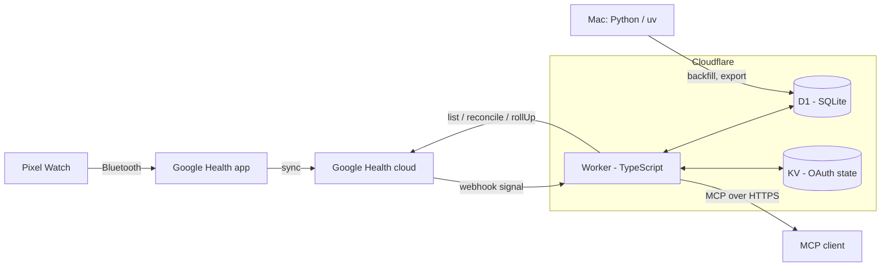

# Architecture

Pixel Health is a single-user pipeline. One Cloudflare Worker syncs Pixel Watch data from the Google Health API into a D1 (SQLite) database, precomputes daily summaries, and serves them as a remote MCP server protected by OAuth 2.1.

## Data flow

1. The watch syncs to the Google Health app, which uploads to the Google Health cloud.
2. A webhook notifies the Worker of a change. The Worker verifies the signature, queues the interval and returns immediately.
3. A cron job drains the queue: it fetches small time windows from the Google Health API, normalizes them and writes them to D1 in batches.
4. Daily summaries are recomputed from the stored data on a schedule.
5. MCP clients query the stored data through read-only tools. They can also insert manual events, such as caffeine or alcohol.

Freshness is bounded by how fast the watch syncs to the Google Health app, not by this pipeline.

## Components

| Component | Location | Role |
|---|---|---|
| Worker | `worker/` | Webhook receiver, sync cron, daily summaries, OAuth provider and MCP server |
| D1 | Cloudflare | Metrics, sleep, workouts, sync queue, daily summaries, tracker events, audit log |
| KV | Cloudflare | OAuth state |
| Offline tooling | `py/` | Historical backfill, export and statistics; reads and writes D1 through the Cloudflare API |

The Worker and the offline tooling do not import each other. They share data only through D1 and the public Worker API.

## Security boundaries

- Google tokens never leave the Worker. The refresh token is stored encrypted.
- The webhook checks the authorization header and the ECDSA signature before it parses the body.
- Only one allowlisted account can sign in. MCP tools are read-only, except an insert-only event logger.
