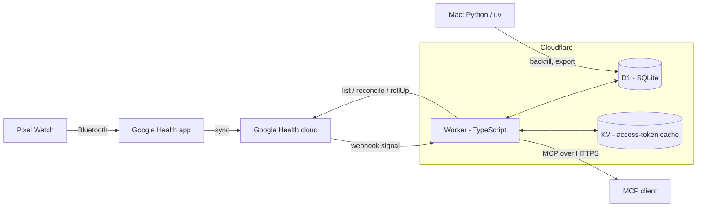

# Architecture

Pixel Health is a single-user pipeline. One Cloudflare Worker syncs Pixel Watch data from the Google Health API into a D1 (SQLite) database, precomputes daily summaries, and serves them as a remote MCP server protected by OAuth 2.1.

## Data flow

1. The watch syncs to the Google Health app, which uploads to the Google Health cloud.
2. A webhook notifies the Worker of a change. The Worker verifies the signature, queues the interval and returns immediately.
3. A cron job drains the queue: it fetches small time windows from the Google Health API, normalizes them and writes them to D1 in batches.
4. Daily summaries are recomputed from the stored data on a schedule.
5. MCP clients query the stored data through read-only tools. They can also insert manual events, such as caffeine or alcohol.

Freshness is bounded by how fast the watch syncs to the Google Health app, not by this pipeline.

## Components

| Component | Location | Role |
|---|---|---|
| Worker | `worker/` | Webhook receiver, sync cron, daily summaries, OAuth provider and MCP server |
| D1 | Cloudflare | Metrics, sleep, workouts, sync queue, daily summaries, tracker events, audit log, Google OAuth state and encrypted refresh token |
| KV | Cloudflare | Google access-token cache |
| Offline tooling | `py/` | Historical backfill, export and statistics; reads and writes D1 through the Cloudflare API |

The Worker and the offline tooling do not import each other. They share data only through D1 and the public Worker API.

## Storage

- Schema lives in `worker/migrations/`; `0002_oauth_state.sql` adds Google consent state. Times are epoch seconds UTC plus `tz_offset_min` per row; `local_date` is derived from both.
- A sleep session is dated by its wake day. Behaviour on day D is compared with the night D to D+1 (`nightOf`).
- `worker/src/lib/time.ts` converts Google `physicalTime` and `utcOffset` and rejects malformed input.
- `worker/src/lib/d1.ts` `upsertRows` writes with `ON CONFLICT DO UPDATE`, so replays are idempotent. It binds at most 100 parameters per statement and sends all chunks in one `DB.batch`.
- Views `v_daily`, `v_events`, `v_sleep` and `v_workouts` are read-only projections for the SQL tool.

## Security boundaries

- Google tokens never leave the Worker. The refresh token is stored encrypted.
- The webhook checks authorization before reading the body and ECDSA before parsing notifications; the bounded verification-handshake exception is described below.
- Only one allowlisted account can sign in. MCP tools are read-only, except an insert-only event logger.

## Webhook

`worker/src/ingest/webhook.ts` compares `Authorization` with `WEBHOOK_SECRET` in constant time before reading the body. An authorized body of at most 64 bytes may be probed as JSON: exactly `{"type":"verification"}` returns 200 unsigned. Other bodies require the base64 Tink signature (0x01, big-endian key id, DER ECDSA P-256/SHA-256) over the original bytes before notification parsing. Authentication failures return 401 without queue writes; headers and bodies are never logged.

`worker/src/lib/signature.ts` caches enabled public keys per isolate. An unknown id fetches the injected Tink keyset once; a successful refresh replaces the entire trusted snapshot. Fetch or parse failures return 503 and preserve the previous cache.

The handler validates every notification before writing through `upsertRows` to `sync_pending`. Physical intervals take precedence; civil-only intervals are interpreted as UTC and widened by 14 hours on each side. Exact end times must follow starts before starts are floored and ends ceiled to epoch seconds. Missing interval representations are skipped. Malformed signed input returns 400 without writes. The queue key includes data type, interval and operation, so duplicates collapse while UPSERT and DELETE remain distinct. Replays refresh `received_at` and preserve `attempts`. A 204 waits for the whole D1 batch; failed writes return 500 for retry. CPU is measured after deployment.

## Google client

`worker/src/google/client.ts` handles Google API requests (token refresh, `list`, heart-rate `rollUp`, `pairedDevices`); callers never build API URLs. The Google connect handler separately exchanges consent codes.

- The access token is cached in one KV key with a TTL of `min(expires_in - 60, 3000)` s. Tokens with `expires_in < 120` are used but not cached; KV write errors are ignored.
- 429 and 5xx are retried up to 3 times per request, waiting `Retry-After` seconds or `500 * 2^n` ms. A 401 drops the cached token and throws. Only 403 `ACCESS_TOKEN_SCOPE_INSUFFICIENT` becomes `MissingScopeError`.
- `rollUpHeartRate` rejects locally (`RangeError`) a range over 14 days or a window that is not a multiple of 60 s.
- `watchLastSync` ignores devices whose `deviceVersion` lacks "Watch" (the phone).

## Google connect

`worker/src/auth/googleHealthConnect.ts` starts consent with the four read-only Google Health scopes plus `openid email`, offline access and PKCE S256. D1 `oauth_state` holds a random state and verifier for 10 minutes. The callback atomically deletes a valid state before checking the code or exchanging it, so failed and concurrent callbacks cannot replay it. Routing is wired in T9.

The ID token is read only from Google's TLS token response; its signature is not checked separately (OIDC §3.1.3.7). Issuer, audience, expiry and the verified, case-insensitive owner email must match before storage. Missing refresh tokens and rejected identities preserve any existing token.

`worker/src/lib/crypto.ts` encrypts the refresh token with AES-256-GCM using a fresh 12-byte IV and `TOKEN_ENC_KEY` (base64 of exactly 32 bytes). The awaited `upsertRows` replaces only `secret_blob.google_refresh_token`. The loader returns null when absent and throws on decryption failure. Responses contain only fixed text; the connect flow logs no tokens or secrets and never uses KV, preserving the client's access-token cache.
