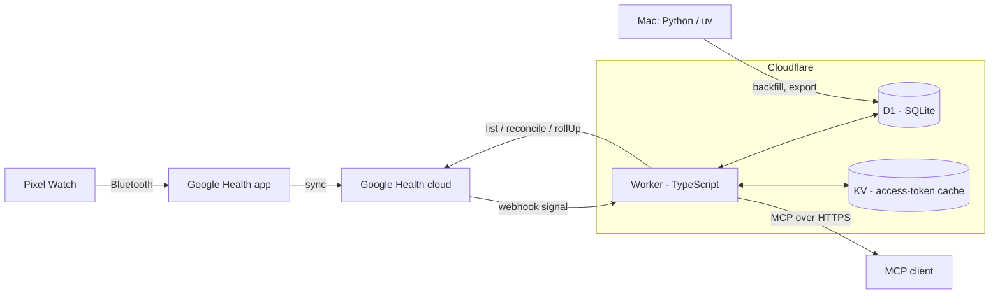

# Architecture

Pixel Health is a single-user pipeline. One Cloudflare Worker syncs Pixel Watch data from the Google Health API into a D1 (SQLite) database, precomputes daily summaries, and serves them as a remote MCP server protected by OAuth 2.1.

## Data flow

1. The watch syncs to the Google Health app, which uploads to the Google Health cloud.
2. A webhook notifies the Worker of a change. The Worker verifies the signature, queues the interval and returns immediately.
3. A cron job drains the queue: it fetches small time windows from the Google Health API, normalizes them and writes them to D1 in batches.
4. Daily summaries are recomputed from the stored data on a schedule.
5. MCP clients query the stored data through read-only tools. They can also insert manual events, such as caffeine, alcohol or mood emotions, and undo a logged event with a soft delete.

Freshness is bounded by how fast the watch syncs to the Google Health app, not by this pipeline.

## Runtime wiring

`worker/src/index.ts` delegates HTTP requests to `app.ts` and runs scheduled work through `ctx.waitUntil`. Every five minutes, the app loads the encrypted Google refresh token and drains the queue when a token exists, then recomputes touched daily summaries and rebuilds tracker summaries for local D−2 through D in `USER_TZ`. A token-load or drain rejection fails the run before summaries. At 04:30 UTC it enqueues the 48-hour reconcile and deletes expired OAuth states; unknown cron expressions throw.

After the drain, runs where `Math.floor(now / 300) % 6 === 0` sample the watch's latest sync every 30 minutes when a Google token exists. One upsert to `sync_state('watch')` stores the floored epoch-second `lastSyncTime`, `last_ok_at` and a cleared error; no paired watch stores a null timestamp. Lookup or timestamp-parse failures preserve the previous successful timestamp and record the first 200 characters of the error. Watch write failures are swallowed so both rollups still run. Non-due runs and runs without a token leave watch state untouched.

Exact routes are `POST /webhooks/google`, `GET /google/connect` and `GET /google/callback`; other methods on these paths return 405, and other paths return 404. The webhook fetches Google's public keyset through the injected fetch dependency. Connect is public until T9 adds login; only `ALLOWED_EMAIL` can store a token. The default, staging and production configurations declare both crons, `USER_TZ` and `ALLOWED_EMAIL`; secrets and deployment resource ids must be provisioned separately.

## Components

| Component | Location | Role |
|---|---|---|
| Worker | `worker/` | Webhook receiver, sync cron, daily summaries, OAuth provider and MCP server |
| D1 | Cloudflare | Metrics, sleep, workouts, sync queue, daily summaries, tracker events, audit log, Google OAuth state and encrypted refresh token |
| KV | Cloudflare | Google access-token cache |
| Offline tooling | `py/` | Historical backfill, export and statistics; reads and writes D1 through the Cloudflare API |

The Worker and the offline tooling do not import each other. They share data only through D1 and the public Worker API.

## Storage

- Schema lives in `worker/migrations/`; `0002_oauth_state.sql` adds Google consent state. Times are epoch seconds UTC plus `tz_offset_min` per row; `local_date` is derived from both.
- `0005_rollup_dirty.sql` adds `rollup_dirty(local_date, version)` and the single-row `rollup_seq(id = 1, n)`, seeded at zero. Each marking statement increments this persistent sequence in the same batch and uses its value for inserted and updated marks; clearing a date never resets the sequence.
- A sleep session is dated by its wake day. Behaviour on day D is compared with the night D to D+1 (`nightOf`).
- `worker/src/lib/time.ts` converts Google `physicalTime` and `utcOffset` and rejects malformed input.
- `worker/src/lib/d1.ts` `upsertRows` writes with `ON CONFLICT DO UPDATE`, so replays are idempotent. It binds at most 100 parameters per statement and sends all chunks in one `DB.batch`.
- Views `v_daily`, `v_events`, `v_sleep` and `v_workouts` are read-only projections for the SQL tool.

## Daily summary

Every successful drain batch marks its covered dates in `rollup_dirty` atomically with data writes and queue removal or advancement. Heart-rate, sleep and exercise mark every UTC date from the actual window's start minus 14 hours through its end plus 14 hours, inclusive. Steps, active-zone-minutes and the five daily-list types mark exactly their civil replacement dates, without widening. Before deleting or replacing sleep sessions and workouts, the batch also marks their stored dates, including replaced source IDs outside the window, and marks every newly written session's date regardless of offset size. Failed types leave no marks. Only real canonical `YYYY-MM-DD` dates in `2000-01-01` through `2099-12-31` are marked; date ranges use a recursive CTE, and ID/date lists use one JSON parameter to keep statement bindings bounded.

After draining, cron removes invalid marks and reads the eligible dirty dates and versions. It adds today's `USER_TZ` date when today's summary is missing. With no eligible dates it skips the daily recompute; future marks remain queued. Otherwise the inclusive range starts at the earliest date and ends at the earliest of the latest date plus 28 days, today, or the start plus 365 days. This refreshes the scores whose history includes changed data. After success it clears only marks whose entire 28-day tail (capped at today) was processed and whose versions still match the snapshot. Re-marks during recompute survive, including delete/reinsert interleavings within the same second; recompute failures retain the dirty work. A large backlog can postpone today's bootstrap, and dates with unfinished tails remain for subsequent ticks, which may repeat some dates. Tracker recomputation remains D−2 through D even when the daily rollup is idle.

`worker/src/rollup/daily.ts` recomputes an inclusive range of 1–366 real calendar dates. One atomic D1 batch first upserts every date's base columns, then updates its z-scores and readiness proxy. Daily metrics and heart-rate wear minutes use source `gh`; sleep and workouts include every source. Main sleep is the non-nap session with the longest time in bed (NULL last), then latest end and descending source id. Its own offset supplies local bedtime and wake time. Missing inputs clear previous values; dates outside the range remain untouched.

Each baseline uses that metric's non-NULL stored summaries from the previous 28 days, including newly written bases in the range. Two-pass mean and sample SD require at least seven values and SD above 1e-9. Readiness is `0.5·z_ln_rmssd − 0.3·z_rhr + 0.2·z_sleep` when all three scores exist; otherwise it is NULL. This is a heuristic to calibrate. Replaying the same inputs, range and timestamp gives identical summaries.

Daily metrics use primary-key searches by metric, source and date range. Heart-rate wear minutes use the primary key's metric, source and timestamp range, widened by 14 hours at each end before filtering each row's local date. Both reads stay bounded to the requested period; sleep uses its date index.

`worker/src/rollup/trackers.ts` atomically rebuilds `tracker_daily` for an inclusive range of 1–366 real calendar dates: live events grouped by stored local date and tracker supply total, count, evening total from 18:00 using each event's offset, and first/last timestamps. All origins and archived trackers count, zero totals retain a row, empty days have no row, and dates outside the range remain untouched.

## MCP read tools

`worker/src/mcp/tools/daily.ts` exposes `healthDaily` as a plain D1 query function. It validates real calendar dates, an inclusive range of 1–90 days and an optional non-empty list of distinct, allowlisted metrics before reading. One bound, read-only query returns `v_daily` rows oldest first as columns and rows, preserving stored values, with units for exactly the returned metrics and coverage as requested days versus days with a row, including rows whose metrics are all NULL. D1 failures reject. MCP registration and formatting follow separately; the formatter will supply per-day sample counts using `hr_wear_min`.

`worker/src/mcp/tools/sleep.ts` exposes `healthSleep`. It validates an inclusive range of 1–31 real calendar dates before reading, then uses two SELECTs bound to those dates for sessions and their stages. It returns every source's main sessions and naps by stored wake date, ordered by start and then source id, with stored summaries (including NULL), start/end at each session's offset, and stage tuples of floored minutes from session start. Stage rows stay separate and are neither clipped nor merged. Coverage counts requested dates and distinct dates with any session, including naps. Queries are stateless, omit source identifiers from the result and reject on either D1 read failure.

`worker/src/mcp/tools/workouts.ts` exposes `healthWorkouts` through the read-only, audited `health_workouts` tool. It validates 1–31 inclusive real dates, then performs one bound SELECT from `workout` by stored `local_date`, ordered by start and source id. All sources are returned with type, start/end local minute timestamps at the session offset, offset minutes, duration, average heart rate, kcal, active zone minutes and distance in meters, plus a count. Numeric summaries round to one decimal; nulls and other stored values pass through. Each call reads afresh and D1 failures reject.

`worker/src/mcp/tools/intraday.ts` exposes `healthIntraday` for `hr` on one real local date from 2000 through 2099 at `1m`, `5m` or `1h` resolution. Optional local `from`/`to` strings define `[from, to)` with `00:00`/`24:00` defaults and require `00:00 ≤ from < to ≤ 24:00`. A `1m` window must span at most 180 minutes; a longer or omitted window is refused with guidance to pass a window or use `5m`. Validation precedes every read. One bound SELECT limits UTC timestamps to midnight minus 14 hours through midnight plus 38 hours (exclusive), filters each row's local date, local `HH:MM` window and source `gh` before aggregation, and aggregates in SQL by floored local bucket and stored offset. Partial `5m`/`1h` buckets keep their canonical start label, which may precede `from`, and contain only samples inside the window. Repeated DST labels remain separate, ordered by each bucket's first UTC timestamp. Points contain local bucket start, unweighted mean rounded to one decimal, and independent stored minima/maxima falling back to the value when NULL. The response includes `bpm` and minute-row coverage counting only the requested window. Reads are uncached and D1 failures reject. The same tool accepts `steps` at `1h` only, reading `steps_h` rows from `gh`. Each stored window returns `[HH:MM, sum, sum, sum]` and coverage counts windows in `hours_with_data`. A window is included when its exact local start is in `[from, to)`, so 08:00 is excluded from `[08:30, 08:45)`. Offsets and UTC ordering preserve repeated DST labels and half-hour starts.

`health_status` uses only D1 SELECTs to report observed `gh` metric and sleep freshness, the latest daily summary, the cached watch sync, queue counts, Google refresh-token presence and 14 local dates of distinct HR-minute coverage. Metric names use primary-key skip-scans followed by a latest-row lookup per metric. Coverage timestamps are bounded from the first date's UTC midnight minus 14 hours through today's UTC midnight plus 38 hours (exclusive), then filtered by stored local date. The watch stream follows daily and reads `sync_state` by its `data_type = 'watch'` primary key, formatting its timestamp in `USER_TZ`. It returns compact summaries without secrets and alerts in Spanish for a missing Google connection, no HR data within 48 hours, stuck queue entries and stale daily summaries. The last alert, `watch_not_syncing`, fires only when Google is connected and the watch timestamp is absent or more than 24 elapsed hours old; exactly 24 hours is healthy, regardless of age rounding. It uses the connector's read-only annotations and audit wrapper. Cloudflare `exceededCpu` outcomes are monitored with `wrangler tail`.

## Security boundaries

- Google tokens never leave the Worker. The refresh token is stored encrypted.
- The webhook checks authorization before reading the body and ECDSA before parsing notifications; the bounded verification-handshake exception is described below.
- Only one allowlisted account can sign in. MCP tools are read-only, except an insert-only event logger and a soft-delete tool for undoing logged events.

## Webhook

`worker/src/ingest/webhook.ts` compares `Authorization` with `WEBHOOK_SECRET` in constant time before reading the body. An authorized body of at most 64 bytes may be probed as JSON: exactly `{"type":"verification"}` returns 200 unsigned. Other bodies require the base64 Tink signature (0x01, big-endian key id, DER ECDSA P-256/SHA-256) over the original bytes before notification parsing. Authentication failures return 401 without queue writes; headers and bodies are never logged.

Webhook secret rotation supports a 24-hour overlap with `WEBHOOK_SECRET_PREV`: both current and previous values are accepted, and both constant-time digest comparisons run whenever the previous value is a string of at least 16 characters. An absent or invalid previous value is ignored; the current value must still pass validation. Set the previous value before replacing the current one, update Google's subscriber, then remove `WEBHOOK_SECRET_PREV` 24 hours after Google accepts the update. Finish this overlap before starting another rotation; the manual procedure is in the README.

`worker/src/lib/signature.ts` caches enabled public keys per isolate. An unknown id fetches the injected Tink keyset once; a successful refresh replaces the entire trusted snapshot. Fetch or parse failures return 503 and preserve the previous cache.

The handler validates every notification before writing through `upsertRows` to `sync_pending`. Physical intervals take precedence; civil-only intervals are interpreted as UTC and widened by 14 hours on each side. Exact end times must follow starts before starts are floored and ends ceiled to epoch seconds. Missing interval representations are skipped. Malformed signed input returns 400 without writes. The queue key includes data type, interval and operation, so duplicates collapse while UPSERT and DELETE remain distinct. Replays refresh `received_at` and preserve `attempts`. A 204 waits for the whole D1 batch; failed writes return 500 for retry. CPU is measured after deployment.

## Queue drain

`worker/src/ingest/drain.ts` processes at most one eligible queue row per supported type in the order below. Rows with fewer than five attempts are ordered by receipt, start, operation (DELETE first), then end. Heart-rate UPSERT fetches a minute-aligned window of at most 60 minutes using a 60-second Google rollUp. Each point replaces its `hr/gh` minute with average, minimum, maximum, null sample count and the DST-aware offset of `USER_TZ`. Other data types stay queued.

Steps and resting heart rate re-read up to 31 local dates touched by the end-exclusive interval in `USER_TZ`, for either UPSERT or DELETE. Steps use `dailyRollUp`; resting heart rate uses `listDaily` and stores `rhr`. The fetched range of `metric_daily` rows for that metric and source `gh` is replaced, removing missing days and skipping missing payloads, invalid calendar dates, non-finite values and out-of-range dates. Rows carry a null source id and the injected epoch-second `now` (current time by default). A capped range continues at UTC midnight of the exclusive range end minus 14 hours, allowing a boundary date to be re-read without skipping dates across DST.

The same daily path handles HRV (`hrv_rmssd`, average variability in milliseconds), oxygen saturation (`spo2`, average percentage), respiratory rate (`resp_rate`, breaths per minute) and sleep temperature (`skin_temp_dev`, nightly Celsius minus baseline Celsius) through `listDaily`. Both temperature components must be finite; zero and negative deviations are valid. Active zone minutes use `dailyRollUp` and store `azm`, summing the present cardio, peak and fat-burn zone values; an absent set or any non-finite component skips the item, while all-zero components store zero. Each run selects one eligible row per type in this order: heart-rate, steps, resting heart rate, sleep, HRV, oxygen saturation, respiratory rate, sleep temperature, active zone minutes, exercise.

Sleep uses `reconcile("sleep", start, end)` for either operation, selecting sessions by end time. Its exclusive window end is the queued end plus one minute, capped at seven days from the start; capped rows continue at that boundary, including a final boundary minute for an exactly seven-day row. Stored `gh` sessions ending in the window and their stages are replaced with the answer, clearing prior stages for returned session ids even when their stored end was outside the window. Sessions store the summary, rounded sleep efficiency, nap flag (a nap when Google's `mainSleep` is not `true`, or when time in bed is under 180 minutes and the local start hour is 09–19; migration `0006_daytime_naps.sql` applied the same rule to stored rows and marked their valid dates dirty), wake date from the session's end offset, and `updated_at`. Invalid sessions or stages are skipped; absent or non-finite summary values become null. Valid timestamps are floored to seconds. The last valid version of a duplicate session wins as a whole, and the later stage wins when stage starts floor to the same second.

Exercise runs last and uses one `reconcile("exercise", start, end)` for either operation, with the same seven-day cap, extra final minute, retry and continuation rules as sleep. One atomic batch deletes `gh` workouts whose start is in the window, upserts the last valid item per `dataPointName` and removes or advances the queue row. Mapping requires non-empty names and types, real zoned interval instants with end after start, and an integer-minute `startUtcOffset`. Instants floor to seconds; the start offset supplies the local date. A valid non-negative seconds `activeDuration` supplies duration minutes, otherwise the floored interval does. Numeric metrics accept numbers or numeric strings; absent or invalid values become null, distance millimeters become meters and max heart rate stays null.

Each type's metric writes and queue removal or continuation share one atomic D1 batch. `upsertStatements` supplies the same validated, 100-parameter chunks as `upsertRows` for this composition. A continuation preserves receipt and attempts; a colliding remainder keeps the latest receipt and fewest attempts. Queue mutations require the selected receipt timestamp, preserving a notification re-received during the fetch. Heart-rate DELETE removes only `hr/gh` minutes in the raw, end-exclusive interval without calling Google. A single error path covers Google calls, mapping, statement binding and the final batch: failures preserve that type's stored data, increment the selected row's attempts, count it as failed and continue with the next type. A failed batch rolls back all writes for that type. If the attempts update itself fails, the drain rejects. The return value sums processed and failed rows across types.

Same-second re-receipts can still be removed, and overlapping fetches can overwrite newer minutes. `worker/src/ingest/poll.ts` queues one UPSERT per drained type for the last 48 hours, with both endpoints floored to the minute. Types whose `sync_state.synced_until` is newer than `now − 20 hours` are skipped; missing or null state is due. One atomic D1 batch merges identical queue windows with the current receipt and zero attempts and records the window end in `synced_until`, preserving other state columns and queued work. The drain re-reads these windows, repairing missed notifications and stale daily, sleep or exercise data. Heart-rate is upsert-only: stale minutes later deleted by Google still require a DELETE notification. The daily cron enqueues this reconcile at 04:30 UTC; exercise is absent from the webhook subscriber and arrives through this daily poll. Deployed CPU measurement remains pending.

## Google client

`worker/src/google/client.ts` handles Google API requests (token refresh, `list`, `reconcile`, `listDaily`, `dailyRollUp`, heart-rate `rollUp`, `pairedDevices`); callers never build API URLs. The Google connect handler separately exchanges consent codes.

- The access token is cached in one KV key with a TTL of `min(expires_in - 60, 3000)` s. Tokens with `expires_in < 120` are used but not cached; KV write errors are ignored.
- 429 and 5xx are retried up to 3 times per request, waiting numeric `Retry-After` seconds capped at 10,000 ms per retry, or the unchanged `500 * 2^n` ms fallback. A 401 drops the cached token and throws. Only 403 `ACCESS_TOKEN_SCOPE_INSUFFICIENT` becomes `MissingScopeError`.
- `rollUpHeartRate` rejects locally (`RangeError`) a range over 14 days or a window that is not a multiple of 60 s. It returns only points whose timestamp, average, minimum and maximum are all finite numbers; malformed points are dropped without failing the row.
- `list`, `reconcile` and `listDaily` return raw items across all pages, including empty pages with continuation tokens. `reconcile` validates types and instants locally, filtering sleep by interval end time and other types by sample time. Exercise uses `exercise.interval.civil_start_time` with civil bounds widened by 14 hours on both sides, lower rounded down and upper rounded up to whole seconds without a zone. After all pages arrive, only real zoned `exercise.interval.startTime` instants in the exact `[start, end)` range remain; arbitrary fractions truncate to milliseconds for that cut.
- Daily methods validate real `YYYY-MM-DD` dates over an end-exclusive civil range. `listDaily` filters `<type_snake>.date` without a span cap. `dailyRollUp` posts numeric civil dates and returns `{date, value}` oldest first, retaining Google's value payload; its limit is 14 days for heart-rate, active-minutes, total-calories and active-energy-burned, and 90 days otherwise.
- `watchLastSync` ignores devices whose `deviceVersion` lacks "Watch" (the phone).

## Google connect

`worker/src/auth/googleHealthConnect.ts` starts consent with the four read-only Google Health scopes plus `openid email`, offline access and PKCE S256. D1 `oauth_state` holds a random state and verifier for 10 minutes. The callback atomically deletes a valid state before checking the code or exchanging it, so failed and concurrent callbacks cannot replay it. The app routes the connect and callback endpoints to these handlers.

The ID token is read only from Google's TLS token response; its signature is not checked separately (OIDC §3.1.3.7). Issuer, audience, expiry and the verified, case-insensitive owner email must match before storage. Missing refresh tokens and rejected identities preserve any existing token. Identity checks run first and retain their 403 response. After a valid identity, the token response's space-separated `scope` must include all four Google Health scopes; otherwise the callback returns 400 `Missing scopes`, preserving the previous token and queue attempts.

`worker/src/lib/crypto.ts` encrypts the refresh token with AES-256-GCM using a fresh 12-byte IV and `TOKEN_ENC_KEY` (base64 of exactly 32 bytes). One awaited atomic D1 batch replaces only `secret_blob.google_refresh_token` and resets every `sync_pending` row with `attempts >= 5` to zero; rows below that threshold keep their attempts. A failure rolls back both token storage and the retry reset. The loader returns null when absent and throws on decryption failure. Responses contain only fixed text; the connect flow logs no tokens or secrets and never uses KV, preserving the client's access-token cache.

## Connector

The default Worker wraps `/mcp` in `OAuthProvider`, constructed once per isolate from `PUBLIC_ORIGIN`. It publishes protected-resource and authorization-server metadata, PKCE S256, CIMD and dynamic public-client registration. `global_fetch_strictly_public` enables CIMD. The provider owns token lifetimes, refresh rotation and its prefixed records in `OAUTH_KV`.

`/authorize` displays escaped client and scope details, the redirect hostname and the CIMD client domain when present. The provider's consent headers and browser-bound, single-use transactions protect consent and upstream Google login. Allow starts Google with `openid email` and PKCE; Deny redirects with `access_denied`. `/oauth/google/callback` consumes the bound state and accepts only an unexpired Google identity with the expected issuer, audience and verified `ALLOWED_EMAIL`, ignoring case. Google tokens are neither stored nor required to include a refresh token. Trusted refusals redirect with `access_denied`; invalid consent or callback transactions return a local 400 without a redirect. Grants and refusals enqueue fixed, secret-free auth audit records.

Each authenticated MCP request creates a stateless Streamable HTTP transport and registers twelve tools: `health_daily`, `health_sleep`, `health_workouts`, `health_intraday`, `health_trackers`, `health_status`, `health_compare`, `health_correlate`, `health_trend` and `health_sql` as read-only tools, plus the insert-only `health_log_event` and soft-delete `health_delete_event`. Loose string schemas leave domain validation to the existing queries; SQL also has a 4000-character schema limit. Results include JSON text and structured content; RangeErrors retain their messages, while other tool errors return fixed text except for SQL's bounded D1 message. Each executed tool enqueues one audit row containing its arguments, outcome and elapsed time. All audits use `ctx.waitUntil`; audit storage failures do not change responses. The existing Google Health connect routes, webhook and both scheduled handlers remain delegated to their existing implementations.

`health_sql` runs the lexical `validateReadOnlyQuery` guard first, then the parser-based `viewsOnly` guard on its normalized SQL. The first refusal throws a RangeError before D1 is touched. Accepted SQL first reads without binding via `.all()` as `SELECT * FROM (\n<sql>\n) LIMIT 201`, restricted by the guards to the four health views and declared CTEs. Only when that read returns zero rows, a second read of the same statement via `raw({ columnNames: true })` supplies column names; failures from either read propagate. The result returns at most 200 rows and stops at the first row that would push `JSON.stringify(rows).length` past 20 000 UTF-16 code units, including JSON escaping, brackets and separators. `truncated` is true only when a row was omitted by either cap; `row_count` counts returned rows. Columns follow the first fetched row's keys, including when that row exceeds the character budget and no rows are emitted, or query metadata when no rows match. Empty results still return column names and `notes_untrusted`. Stored cells remain unchanged, and `notes_untrusted` is true exactly when a returned column is named `note`. The tool description lists view columns, examples, limits, parser rewrite hints and the untrusted-note warning. Window functions require `PARTITION BY` (`PARTITION BY 1` for the whole table); window frames (`ROWS/RANGE BETWEEN`) are unsupported. The description includes a correlated subquery over `v_daily` for a rolling 7-day average and recommends double quotes for identifiers. The connector returns refusals as tool errors and maps D1 failures to `query failed: ` plus the first 200 message characters; both outcomes audit the original query through `call`. SDK argument-validation failures run no query or tool audit.

The analysis tools accept 1–365 anchor dates in 2000–2099 and perform one bound `SELECT` from `v_daily`, widening the end by the requested lag (0–7 days, possibly into 2100). A complete UTC calendar grid preserves missing dates. Missing or non-finite behavior values become zero; missing or non-finite outcomes remain null. `health_compare` pairs behavior on D with outcome on D + lag (default 1, matching sleep's wake date), groups by inclusive positive thresholds, and compares each eligible group with the first group having at least two observations. It returns sample SD and Welch–Satterthwaite degrees of freedom with Student t 95% confidence intervals; two constant groups retain their difference with null df and interval.

`health_correlate` estimates x's AR(1) coefficient from adjacent present anchor values, centred with the mean of all present anchor values. Fewer than three pairs or zero denominator gives phi zero; otherwise phi is clamped to [−0.99, 0.99]. Both series are filtered with that same unrounded phi over the widened window; the first date and dates adjacent to missing values remain null. Lags 0 through `max_lag` (default 3) pair filtered x anchors with later filtered y values. Pearson r is null with fewer than five pairs or zero variance. Pure statistics live in `stats.ts`; only result numbers use `Math.round(v * 1000) / 1000`. Both tools return the fixed caveat `Asociacional, no causal. n=<n>. Posibles confusores: alcohol, entrenamiento, hora de acostarse, enfermedad.`, using the aligned-pair count for compare and lag-0 count for correlate.

`health_trend` reuses the analysis series with zero lag: one bound SELECT reads exactly the requested 1–365 dates, then aggregation runs in memory. Every intersecting ISO week (Monday start) or calendar month appears oldest first, including empty and partial periods. Each bucket reports its period start, requested days, non-null count, mean, sample SD, min, max and z. The baseline uses all non-null daily values in the requested range; z compares each bucket mean with that baseline using unrounded values. Empty means and extrema, sample SD with fewer than two values, and z with an absent or zero baseline SD are null. Output numbers round to three decimals and the tool returns the fixed descriptive caveat about partial periods having fewer days.

## Trackers

`0003_tracker_seed.sql` seeds Cigarrillos (u, count, default 1, limits 1–20), Alcohol (g, amount, default 13, limits 1–200) and Cafeína (mg, amount, default 80, limits 1–1000) with `INSERT OR IGNORE`, preserving existing configuration. `health_trackers` reads active trackers and exact totals/counts from live events by stored local date, plus the first 50 events ordered by timestamp and id with an explicit truncation flag. Local times use stored offsets. Every returned note is untrusted and bounded to 280 code points without changing storage; emoji-heavy listings may exceed the usual approximate output budget (accepted R8 exception).

`health_log_event` validates tracker-driven limits, a strict millisecond-precision RFC 3339 instant within the last seven days through five minutes ahead, and a trimmed 280-code-point note before inserting. The event's `USER_TZ` offset supplies its local date. A valid idempotency key replays the existing event before other validation; concurrent inserts use `ON CONFLICT(id) DO NOTHING` and re-read the winner. A new event, its date's `tracker_daily` rebuild and the live-event total run in one D1 batch, so a failure stores nothing and a retry is safe. Replays and conflict losers rebuild and read the stored event's date in their own batch (SELECT only when that stored date is invalid). The tracker tools use the existing `health:read` grant and audit wrapper, including the owner's note in logger audit arguments.

`health_delete_event({ event_id })` undoes the event identified by `health_log_event`'s returned `event.id`. It sets `deleted_at` rather than removing history; there is no restore tool. For a live event, one D1 batch conditionally updates only a still-live row, rebuilds its stored date's `tracker_daily` and reads the live `SUM(value)` for that tracker and date (zero when empty). Invalid stored dates skip the rebuild. The result is `{ deleted, event, day_total }`, with the logger's event shape and bounded untrusted note; unrepresentable stored timestamps return `local_time: null`. Stored values, dates and offsets are preserved even after tracker archival or limit changes. An already-deleted event returns `deleted: false` and the current total without writes. Concurrent callers produce exactly one `deleted: true`, preserve the first deletion timestamp and may harmlessly rebuild the same rollup; any batch failure rolls back the deletion and rollup. Unknown IDs raise `RangeError("event_id must name an existing event")`. The connector requires a string of 1–80 characters before `call` (SDK refusals have no tool audit), marks the tool destructive and idempotent, and audits executed calls using the existing `health:read` grant.

`0007_mood_trackers.sql` adds eight trackers with `INSERT OR IGNORE`, preserving configured and archived rows: `mood_genial` (Ánimo: genial), `mood_bien` (Ánimo: bien), `mood_tranquilo` (Ánimo: tranquilo), `mood_cansado` (Ánimo: cansado), `mood_estresado` (Ánimo: estresado), `mood_ansioso` (Ánimo: ansioso), `mood_triste` (Ánimo: triste) and `mood_enfadado` (Ánimo: enfadado). Each is a count tracker with unit `u`, default 1 and limits 1–1, allowing several emotions per day through `health_log_event` and the normal event/`tracker_daily` pipeline. Mood analysis currently uses `health_sql` over `v_events`; `v_daily` and the analysis tools' behavior allowlist stay unchanged.

After integration, add `<PUBLIC_ORIGIN>/oauth/google/callback` to the Google OAuth client's redirect URIs, deploy, connect the MCP client through CIMD and verify web and Android access. Check production `tools/list` and cached-token call CPU with `wrangler tail` against the 10 ms budget.

### Hourly steps

Migration `0008_hourly_steps.sql` adds `steps_h` (`count`, `sum`) to `metric_def`.
`rollUpSteps` posts a `3600s` window to the steps rollUp endpoint. It uses the shared authentication,
retry and error handling, validates a positive range of at most 14 elapsed days, rejects unexpected
paging, and reads flat `startTime` and `steps.countSum` fields from the
[Google aggregation reference](https://developers.google.com/health/aggregate-data).
Finite non-negative integer counts (including numeric strings and zero) and valid timestamps survive parsing.
No wire offset is required: the drain derives each stored offset from `USER_TZ` as for heart rate.

A steps drain fetches hourly windows for exactly the same capped slice of at most 31 local dates
as its daily request. Consecutive chunks contain at most 13 dates, from local midnight to the next
chunk's midnight converted to UTC; this stays under 14 elapsed days over fall-back. Windows begin
at the request start and advance by UTC hours. The drain drops points outside each request's
`[start, end)` range and replaces only `gh/steps_h` rows inside those bounds, storing the hour's sum
in `value`, `vmin` and `vmax` in `metric_minute`. Daily writes, hourly replacements, dirty marks and
queue completion share one D1 batch. Each chunk inserts hourly windows with one bound JSON array
and `json_each`, keeping a full 31-date slice within the D1 query budget.
A call or write failure preserves all stored data and the queue,
increments attempts and permits retry; concurrent receipts and daily continuation retain their existing behavior.
`daily_summary` and its rollup continue using daily steps as the source of truth for totals.
