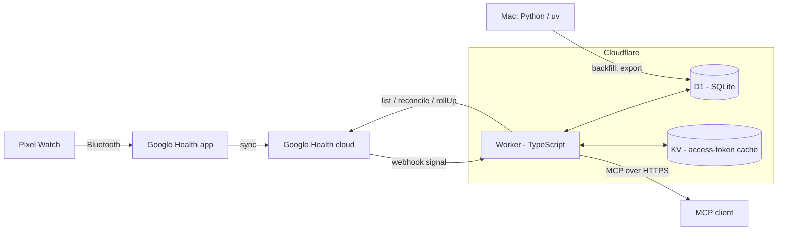

# Architecture

Pixel Health is a single-user pipeline. One Cloudflare Worker syncs Pixel Watch data from the Google Health API into a D1 (SQLite) database, precomputes daily summaries, and serves them as a remote MCP server protected by OAuth 2.1.

## Data flow

1. The watch syncs to the Google Health app, which uploads to the Google Health cloud.
2. A webhook notifies the Worker of a change. The Worker verifies the signature, queues the interval and returns immediately.
3. A cron job drains the queue: it fetches small time windows from the Google Health API, normalizes them and writes them to D1 in batches.
4. Daily summaries are recomputed from the stored data on a schedule.
5. MCP clients query the stored data through read-only tools. They can also insert manual events, such as caffeine or alcohol.

Freshness is bounded by how fast the watch syncs to the Google Health app, not by this pipeline.

## Runtime wiring

`worker/src/index.ts` delegates HTTP requests to `app.ts` and runs scheduled work through `ctx.waitUntil`. Every five minutes, the app loads the encrypted Google refresh token and drains the queue when a token exists, then recomputes daily and tracker summaries for local D−2 through D in `USER_TZ`. A token-load or drain rejection fails the run before summaries. At 04:30 UTC it enqueues the 48-hour reconcile and deletes expired OAuth states; unknown cron expressions throw.

Exact routes are `POST /webhooks/google`, `GET /google/connect` and `GET /google/callback`; other methods on these paths return 405, and other paths return 404. The webhook fetches Google's public keyset through the injected fetch dependency. Connect is public until T9 adds login; only `ALLOWED_EMAIL` can store a token. The default, staging and production configurations declare both crons, `USER_TZ` and `ALLOWED_EMAIL`; secrets and deployment resource ids must be provisioned separately.

## Components

| Component | Location | Role |
|---|---|---|
| Worker | `worker/` | Webhook receiver, sync cron, daily summaries, OAuth provider and MCP server |
| D1 | Cloudflare | Metrics, sleep, workouts, sync queue, daily summaries, tracker events, audit log, Google OAuth state and encrypted refresh token |
| KV | Cloudflare | Google access-token cache |
| Offline tooling | `py/` | Historical backfill, export and statistics; reads and writes D1 through the Cloudflare API |

The Worker and the offline tooling do not import each other. They share data only through D1 and the public Worker API.

## Storage

- Schema lives in `worker/migrations/`; `0002_oauth_state.sql` adds Google consent state. Times are epoch seconds UTC plus `tz_offset_min` per row; `local_date` is derived from both.
- A sleep session is dated by its wake day. Behaviour on day D is compared with the night D to D+1 (`nightOf`).
- `worker/src/lib/time.ts` converts Google `physicalTime` and `utcOffset` and rejects malformed input.
- `worker/src/lib/d1.ts` `upsertRows` writes with `ON CONFLICT DO UPDATE`, so replays are idempotent. It binds at most 100 parameters per statement and sends all chunks in one `DB.batch`.
- Views `v_daily`, `v_events`, `v_sleep` and `v_workouts` are read-only projections for the SQL tool.

## Daily summary

`worker/src/rollup/daily.ts` recomputes an inclusive range of 1–366 real calendar dates. One atomic D1 batch first upserts every date's base columns, then updates its z-scores and readiness proxy. Daily metrics and heart-rate wear minutes use source `gh`; sleep and workouts include every source. Main sleep is the non-nap session with the longest time in bed (NULL last), then latest end and descending source id. Its own offset supplies local bedtime and wake time. Missing inputs clear previous values; dates outside the range remain untouched.

Each baseline uses that metric's non-NULL stored summaries from the previous 28 days, including newly written bases in the range. Two-pass mean and sample SD require at least seven values and SD above 1e-9. Readiness is `0.5·z_ln_rmssd − 0.3·z_rhr + 0.2·z_sleep` when all three scores exist; otherwise it is NULL. This is a heuristic to calibrate. Replaying the same inputs, range and timestamp gives identical summaries.

Daily metrics use primary-key searches by metric, source and date range. Heart-rate wear minutes use the primary key's metric, source and timestamp range, widened by 14 hours at each end before filtering each row's local date. Both reads stay bounded to the requested period; sleep uses its date index.

`worker/src/rollup/trackers.ts` atomically rebuilds `tracker_daily` for an inclusive range of 1–366 real calendar dates: live events grouped by stored local date and tracker supply total, count, evening total from 18:00 using each event's offset, and first/last timestamps. All origins and archived trackers count, zero totals retain a row, empty days have no row, and dates outside the range remain untouched.

## MCP read tools

`worker/src/mcp/tools/daily.ts` exposes `healthDaily` as a plain D1 query function. It validates real calendar dates, an inclusive range of 1–90 days and an optional non-empty list of distinct, allowlisted metrics before reading. One bound, read-only query returns `v_daily` rows oldest first as columns and rows, preserving stored values, with units for exactly the returned metrics and coverage as requested days versus days with a row, including rows whose metrics are all NULL. D1 failures reject. MCP registration and formatting follow separately; the formatter will supply per-day sample counts using `hr_wear_min`.

`worker/src/mcp/tools/sleep.ts` exposes `healthSleep`. It validates an inclusive range of 1–31 real calendar dates before reading, then uses two SELECTs bound to those dates for sessions and their stages. It returns every source's main sessions and naps by stored wake date, ordered by start and then source id, with stored summaries (including NULL), start/end at each session's offset, and stage tuples of floored minutes from session start. Stage rows stay separate and are neither clipped nor merged. Coverage counts requested dates and distinct dates with any session, including naps. Queries are stateless, omit source identifiers from the result and reject on either D1 read failure.

`worker/src/mcp/tools/intraday.ts` exposes `healthIntraday` for `hr` on one real local date from 2000 through 2099 at `1m`, `5m` or `1h` resolution. Validation precedes every read. One bound SELECT limits UTC timestamps to midnight minus 14 hours through midnight plus 38 hours (exclusive), filters each row's local date and source `gh`, and aggregates in SQL by floored local bucket and stored offset. Repeated DST labels remain separate, ordered by each bucket's first UTC timestamp. Points contain local bucket start, unweighted mean rounded to one decimal, and independent stored minima/maxima falling back to the value when NULL. The response includes `bpm` and matching minute-row coverage. Reads are uncached and D1 failures reject.

## Security boundaries

- Google tokens never leave the Worker. The refresh token is stored encrypted.
- The webhook checks authorization before reading the body and ECDSA before parsing notifications; the bounded verification-handshake exception is described below.
- Only one allowlisted account can sign in. MCP tools are read-only, except an insert-only event logger.

## Webhook

`worker/src/ingest/webhook.ts` compares `Authorization` with `WEBHOOK_SECRET` in constant time before reading the body. An authorized body of at most 64 bytes may be probed as JSON: exactly `{"type":"verification"}` returns 200 unsigned. Other bodies require the base64 Tink signature (0x01, big-endian key id, DER ECDSA P-256/SHA-256) over the original bytes before notification parsing. Authentication failures return 401 without queue writes; headers and bodies are never logged.

`worker/src/lib/signature.ts` caches enabled public keys per isolate. An unknown id fetches the injected Tink keyset once; a successful refresh replaces the entire trusted snapshot. Fetch or parse failures return 503 and preserve the previous cache.

The handler validates every notification before writing through `upsertRows` to `sync_pending`. Physical intervals take precedence; civil-only intervals are interpreted as UTC and widened by 14 hours on each side. Exact end times must follow starts before starts are floored and ends ceiled to epoch seconds. Missing interval representations are skipped. Malformed signed input returns 400 without writes. The queue key includes data type, interval and operation, so duplicates collapse while UPSERT and DELETE remain distinct. Replays refresh `received_at` and preserve `attempts`. A 204 waits for the whole D1 batch; failed writes return 500 for retry. CPU is measured after deployment.

## Queue drain

`worker/src/ingest/drain.ts` processes at most one eligible queue row per supported type in the order below. Rows with fewer than five attempts are ordered by receipt, start, operation (DELETE first), then end. Heart-rate UPSERT fetches a minute-aligned window of at most 60 minutes using a 60-second Google rollUp. Each point replaces its `hr/gh` minute with average, minimum, maximum, null sample count and the DST-aware offset of `USER_TZ`. Other data types stay queued.

Steps and resting heart rate re-read up to 31 local dates touched by the end-exclusive interval in `USER_TZ`, for either UPSERT or DELETE. Steps use `dailyRollUp`; resting heart rate uses `listDaily` and stores `rhr`. The fetched range of `metric_daily` rows for that metric and source `gh` is replaced, removing missing days and skipping missing payloads, invalid calendar dates, non-finite values and out-of-range dates. Rows carry a null source id and the injected epoch-second `now` (current time by default). A capped range continues at UTC midnight of the exclusive range end minus 14 hours, allowing a boundary date to be re-read without skipping dates across DST.

The same daily path handles HRV (`hrv_rmssd`, average variability in milliseconds), oxygen saturation (`spo2`, average percentage), respiratory rate (`resp_rate`, breaths per minute) and sleep temperature (`skin_temp_dev`, nightly Celsius minus baseline Celsius) through `listDaily`. Both temperature components must be finite; zero and negative deviations are valid. Active zone minutes use `dailyRollUp` and store `azm`, summing the present cardio, peak and fat-burn zone values; an absent set or any non-finite component skips the item, while all-zero components store zero. Each run selects one eligible row per type in this order: heart-rate, steps, resting heart rate, sleep, HRV, oxygen saturation, respiratory rate, sleep temperature, active zone minutes.

Sleep uses `reconcile("sleep", start, end)` for either operation, selecting sessions by end time. Its exclusive window end is the queued end plus one minute, capped at seven days from the start; capped rows continue at that boundary, including a final boundary minute for an exactly seven-day row. Stored `gh` sessions ending in the window and their stages are replaced with the answer, clearing prior stages for returned session ids even when their stored end was outside the window. Sessions store the summary, rounded sleep efficiency, nap flag, wake date from the session's end offset, and `updated_at`. Invalid sessions or stages are skipped; absent or non-finite summary values become null. Valid timestamps are floored to seconds. The last valid version of a duplicate session wins as a whole, and the later stage wins when stage starts floor to the same second.

Each type's metric writes and queue removal or continuation share one atomic D1 batch. `upsertStatements` supplies the same validated, 100-parameter chunks as `upsertRows` for this composition. A continuation preserves receipt and attempts; a colliding remainder keeps the latest receipt and fewest attempts. Queue mutations require the selected receipt timestamp, preserving a notification re-received during the fetch. Heart-rate DELETE removes only `hr/gh` minutes in the raw, end-exclusive interval without calling Google. Google errors increment attempts, retain the row and let other types run; D1 errors reject immediately and roll back that type's batch. The return value sums processed and failed rows across types.

Same-second re-receipts can still be removed, and overlapping fetches can overwrite newer minutes. `worker/src/ingest/poll.ts` queues one UPSERT per drained type for the last 48 hours, with both endpoints floored to the minute. Types whose `sync_state.synced_until` is newer than `now − 20 hours` are skipped; missing or null state is due. One atomic D1 batch merges identical queue windows with the current receipt and zero attempts and records the window end in `synced_until`, preserving other state columns and queued work. The drain re-reads these windows, repairing missed notifications and stale daily or sleep data. Heart-rate is upsert-only: stale minutes later deleted by Google still require a DELETE notification. The daily cron enqueues this reconcile at 04:30 UTC; polling non-webhook types is deferred. Deployed CPU measurement remains pending.

## Google client

`worker/src/google/client.ts` handles Google API requests (token refresh, `list`, `reconcile`, `listDaily`, `dailyRollUp`, heart-rate `rollUp`, `pairedDevices`); callers never build API URLs. The Google connect handler separately exchanges consent codes.

- The access token is cached in one KV key with a TTL of `min(expires_in - 60, 3000)` s. Tokens with `expires_in < 120` are used but not cached; KV write errors are ignored.
- 429 and 5xx are retried up to 3 times per request, waiting `Retry-After` seconds or `500 * 2^n` ms. A 401 drops the cached token and throws. Only 403 `ACCESS_TOKEN_SCOPE_INSUFFICIENT` becomes `MissingScopeError`.
- `rollUpHeartRate` rejects locally (`RangeError`) a range over 14 days or a window that is not a multiple of 60 s.
- `list`, `reconcile` and `listDaily` return raw items across all pages, including empty pages with continuation tokens. `reconcile` validates types and instants locally, filtering sleep and exercise by interval end time and other types by sample time.
- Daily methods validate real `YYYY-MM-DD` dates over an end-exclusive civil range. `listDaily` filters `<type_snake>.date` without a span cap. `dailyRollUp` posts numeric civil dates and returns `{date, value}` oldest first, retaining Google's value payload; its limit is 14 days for heart-rate, active-minutes, total-calories and active-energy-burned, and 90 days otherwise.
- `watchLastSync` ignores devices whose `deviceVersion` lacks "Watch" (the phone).

## Google connect

`worker/src/auth/googleHealthConnect.ts` starts consent with the four read-only Google Health scopes plus `openid email`, offline access and PKCE S256. D1 `oauth_state` holds a random state and verifier for 10 minutes. The callback atomically deletes a valid state before checking the code or exchanging it, so failed and concurrent callbacks cannot replay it. The app routes the connect and callback endpoints to these handlers.

The ID token is read only from Google's TLS token response; its signature is not checked separately (OIDC §3.1.3.7). Issuer, audience, expiry and the verified, case-insensitive owner email must match before storage. Missing refresh tokens and rejected identities preserve any existing token.

`worker/src/lib/crypto.ts` encrypts the refresh token with AES-256-GCM using a fresh 12-byte IV and `TOKEN_ENC_KEY` (base64 of exactly 32 bytes). The awaited `upsertRows` replaces only `secret_blob.google_refresh_token`. The loader returns null when absent and throws on decryption failure. Responses contain only fixed text; the connect flow logs no tokens or secrets and never uses KV, preserving the client's access-token cache.

## Connector

The default Worker wraps `/mcp` in `OAuthProvider`, constructed once per isolate from `PUBLIC_ORIGIN`. It publishes protected-resource and authorization-server metadata, PKCE S256, CIMD and dynamic public-client registration. `global_fetch_strictly_public` enables CIMD. The provider owns token lifetimes, refresh rotation and its prefixed records in `OAUTH_KV`.

`/authorize` displays escaped client and scope details, the redirect hostname and the CIMD client domain when present. The provider's consent headers and browser-bound, single-use transactions protect consent and upstream Google login. Allow starts Google with `openid email` and PKCE; Deny redirects with `access_denied`. `/oauth/google/callback` consumes the bound state and accepts only an unexpired Google identity with the expected issuer, audience and verified `ALLOWED_EMAIL`, ignoring case. Google tokens are neither stored nor required to include a refresh token. Trusted refusals redirect with `access_denied`; invalid consent or callback transactions return a local 400 without a redirect. Grants and refusals enqueue fixed, secret-free auth audit records.

Each authenticated MCP request creates a stateless Streamable HTTP transport and registers only `health_daily`, `health_sleep` and `health_intraday` as read-only tools. Loose string schemas leave domain validation to the existing queries. Results include JSON text and structured content; RangeErrors retain their messages, while other tool errors return fixed text. Each executed tool enqueues one audit row containing its arguments, outcome and elapsed time. All audits use `ctx.waitUntil`; audit storage failures do not change responses. The existing Google Health connect routes, webhook and both scheduled handlers remain delegated to their existing implementations.

After integration, add `<PUBLIC_ORIGIN>/oauth/google/callback` to the Google OAuth client's redirect URIs, deploy, connect the MCP client through CIMD and verify web and Android access. Check production `tools/list` and cached-token call CPU with `wrangler tail` against the 10 ms budget.
