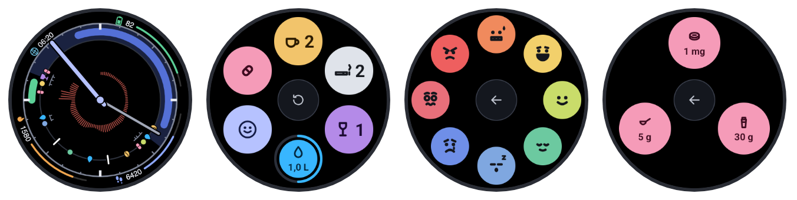

# Watch face



The `wear/` folder holds a Wear OS watch face that shows today's dial (sleep, workouts, logs and heart rate) on the watch, with native hands and four editable edge complications; tapping the centre opens a log menu for coffee, cigarettes, drinks, water, mood and supplements. It has two modules:

| Module | Package | What it is |
|---|---|---|
| `app` | `com.deluispablo.healthtracker` | Fetches `GET /watch/today` from the Worker every hour, renders the dial to an image and serves it as a complication |
| `watchface` | `com.deluispablo.healthtracker.watchface` | A resource-only Watch Face Format (v4) face: bezel, 24-hour hour hand, minute hand, the dial image and four edge slots |

It needs Wear OS 6 or later (Watch Face Format v4). It was built for a 41 mm Pixel Watch 3; other round watches should work. It is sideloaded with ADB, not published on Play.

## 1. Worker token

The watch authenticates with one bearer token. Generate a random value and store it as a Worker secret:

```bash
openssl rand -base64 32
cd worker
npx wrangler secret put WATCH_TOKEN --config wrangler.production.jsonc
```

Keep the value; the watch build needs it in the next step.

## 2. Toolchain

- JDK 17
- Android SDK command-line tools with `platforms;android-36`, `build-tools;36.0.0` and `platform-tools`

On macOS with Homebrew:

```bash
brew install openjdk@17 android-commandlinetools
export JAVA_HOME=/opt/homebrew/opt/openjdk@17
export ANDROID_HOME=/opt/homebrew/share/android-commandlinetools
sdkmanager "platforms;android-36" "build-tools;36.0.0" "platform-tools"
export PATH="$ANDROID_HOME/platform-tools:$PATH"
```

Use the SDK's `adb` (`$ANDROID_HOME/platform-tools/adb`). The standalone Homebrew `adb` cask can fail to connect over Wi-Fi with "No route to host".

## 3. Local configuration

Create `wear/local.properties` (git-ignored). Every Gradle task needs it, including the face module and the unit tests:

```properties
sdk.dir=/opt/homebrew/share/android-commandlinetools
watchToken=<the WATCH_TOKEN value>
watchBaseUrl=https://<your-domain>
userTz=Europe/Madrid
```

`watchToken`, `watchBaseUrl` and `userTz` are compiled into the `app` build. `userTz` defaults to `Europe/Madrid`, must be a valid Java time-zone ID (for example, `UTC`) and must match the Worker's `USER_TZ`. Invalid zones fail the Gradle build. Never commit this file.

## 4. Pair the watch

1. On the watch: **Settings → System → About → Versions**, tap **Build number** seven times to enable developer options.
2. **Settings → Developer options**: turn on **ADB debugging** and **Wireless debugging**. Keep the watch and the computer on the same Wi-Fi.
3. In **Wireless debugging → Pair new device**, note the pairing code and `IP:port`, then:

   ```bash
   adb pair <ip>:<pairing-port>     # enter the pairing code
   adb connect <ip>:<port>          # the port shown on the Wireless debugging screen
   adb devices                      # the watch should be listed
   ```

## 5. Build and install

```bash
cd wear
./gradlew :app:installDebug :watchface:installDebug
```

Then set the face:

```bash
adb shell am broadcast -a com.google.android.wearable.app.DEBUG_SURFACE \
  --es operation set-watchface \
  --es watchFaceId com.deluispablo.healthtracker.watchface
```

You can also pick **Health Tracker** from the watch's face picker or the phone's watch app.

The first sync runs when the app starts, then every 60 minutes while the watch has a connection. Until the first image arrives the face shows "Toca para activar". Tapping the centre of the face opens the log menu, which also requests a best-effort immediate sync, since the hourly job can be deferred while the screen is off; swipe back to close it without logging. A separate job redraws the cache every 15 minutes without needing a connection, keeps stale dimming current and clears yesterday's data after local midnight in `userTz`. WorkManager timing is approximate. The hands update once per minute.

## 6. Edge complications and logging

The four slots sit on the diagonals of the bezel. By default they show battery (top-right), steps (bottom-right), Fitbit calories (bottom-left, empty without the Fitbit app) and world clock (top-left); each diagonal tints its icon and progress in its own colour. Long-press the face (or use the phone's watch app) and choose **Edit** to change them. Edge slots accept providers with progress (`RANGED_VALUE` or `GOAL_PROGRESS`), shown as icon, value and a progress arc on one curved line, and short text (`SHORT_TEXT`), shown as icon and text centred on the diagonal. The lower slots read upright. They hide in ambient mode, which shows only the bezel, the hands and the night's sleep.

Tapping the centre of the face opens the log menu: six solid round buttons in a ring.

| Button | Shows | One tap |
|---|---|---|
| Coffee, cigarette, drink | Today's count | Logs one and closes |
| Water | Today's ml or litres, with a ring filling towards the daily goal (`water_goal_ml`, 2 L by default) | Logs 250 ml and closes |
| Mood | | Opens a ring of eight mood faces in Mood Meter colours, ordered by energy (top) and pleasantness (right) |
| Supplements | | Opens a ring of the supplements in the catalog (melatonin 1 mg, protein shake 30 g, creatine 5 g), each with today's dose |

In the mood and supplement rings a back button sits in the middle, and picking one shows its name in the centre for a moment before closing. Water and supplements need a Worker that sends the tracker catalog in `GET /watch/today`; with an older Worker the menu offers coffee, cigarette, drink and mood only. The menu reads that catalog, so a supplement added to the catalog appears in the ring with no app change (with its initial until it has a glyph). For 15 minutes after a watch log, an undo button sits in the middle of the menu: it takes back that last log, whatever it was, sending `DELETE /watch/log` with the same key if it already reached the Worker. The new log appears on the dial at once.

The dial's log ring marks each log where it happened: a white line for a cigarette, an amber bean for coffee, a violet wine glass for a drink, a blue drop for water, a rose capsule for any supplement and a dot in the mood's colour for a mood. The menu buttons use the same colours. Glyphs and colours are shared with the dashboard; the sources are in `docs/assets/brand/trackers/`.

Every log is queued on the watch first, with a random id as its idempotency key and the tap time as the event time, then sent to `POST /watch/log` when there is a connection. A tap is removed from the queue once `GET /watch/today` shows it (each watch log comes back with its key), or once a dial requested after the Worker accepted it arrives, so a log deleted elsewhere or made on another day does not stay queued. Retries and overlapping refreshes never double-count, and a slower, older response never overwrites a newer one. The endpoint accepts only the trackers in the watch catalog and rejects taps older than seven days. Watch keys are stored apart from MCP keys, so the watch token can neither read back nor undo a log made elsewhere. The Worker stores watch logs like any other log; undo one from the dashboard or with `health_delete_event`.

## Worker catalog and response

`GET /watch/today` adds `water: {ml, goal_ml}` and `trackers: [{id, name, unit, value, surface, today}]`. Water `ml` sums today's live stored water doses. `goal_ml` comes from the profile's `water_goal_ml`, defaults to 2000, and falls back to 2000 for corrupt stored values; database failures propagate. Both `health_profile` and `health_set_profile` return `water_goal_ml`; updates accept integers from 500–6000 ml.

Migration 0015 adds `surface` (`face` or `tile`) and `sort` to the tracker catalog and seeds `water` (250 ml), `melatonin` (1 mg), `protein` (30 g) and `creatine` (5 g). Water uses `face`; the three supplements use `tile`. Existing rows with these ids retain their configuration, events and rollups and receive the assigned surface/order.

The watch catalog is ordered by `sort`, then `id`. It lists only rows with non-NULL `default_value`, non-NULL `surface`, and NULL `archived_at`. `value` is the current default dose. `today` uses live events on the stored local date: sum of stored values for count and amount trackers, latest value for scales, or 0 when empty. Changing the default dose does not change historical amounts. Legacy `totals` and `counts` keep their original rules: a single three-cigarette event contributes 3, while an amount or scale event contributes 1.

`POST /watch/log` logs the catalog default; `DELETE /watch/log` undoes a watch key. Both refuse archived rows or rows with NULL default/surface, including a surface removed after logging. Historical events remain visible and contribute to totals and water amounts. Any custom tile tracker inserted in the database is listed, loggable and undoable without code changes. Tile events use `{t, k:"suplemento", id}`; water uses `k:"agua"`. Watch events also include `i`, their idempotency key. Retrying a log or undo never duplicates or resurrects an event.

## Troubleshooting

- **`adb shell screencap` shows only the bezel and hands.** The watch was in ambient mode; wake it (`adb shell input keyevent KEYCODE_WAKEUP`) and capture again.
- **A log button tap does nothing.** Check `adb logcat -s LogWorker`; queued taps live in the app's `taps.json` until the Worker confirms them.
- **The dial never appears.** Check the app's sync log with `adb logcat -s SyncWorker`. A 401 means `watchToken` does not match the `WATCH_TOKEN` secret; rebuild after fixing `local.properties`.
- **The dial looks faded.** The data is more than three hours old; the watch has not reached the Worker since.
- **An edge complication shows a frozen sample value** (for example a world clock stuck at 10:10, or steps and calories that do not move) after editing the slots. The face kept the editor's preview data; switch to another face and back, or restart the face runtime with `adb shell am force-stop com.google.wear.watchface.runtime`.
- **Change the face** in `wear/watchface/generate.py`, not in the XML: run `python3 generate.py` from `wear/watchface` to rewrite `src/main/res/raw/watchface.xml`.
- **Validate the face XML** after regenerating `wear/watchface/src/main/res/raw/watchface.xml` with the [Watch Face Format validator](https://github.com/google/watchface/releases): `java -jar wff-validator.jar 4 wear/watchface/src/main/res/raw/watchface.xml`.

## Preview images

The images in this document and the face picker preview use sample data, never a real day. To make new ones:

1. Build and install the preview app, a separate app with no token that never reaches a Worker: `./gradlew :app:installDebug -Ppreview` from `wear/`.
2. Load the sample day into it:

   ```bash
   adb push watchface/preview/sample-day.json /data/local/tmp/day.json
   adb shell "run-as com.deluispablo.healthtracker.preview sh -c 'mkdir -p files && cp /data/local/tmp/day.json files/dial.json'"
   ```

   Set `date` in the JSON to today first, or the dial starts empty.
3. Open its menu with `adb shell am start -n com.deluispablo.healthtracker.preview/com.deluispablo.healthtracker.LogActivity`, then capture each screen with `adb shell screencap -p /sdcard/menu.png` and `adb pull`. The app renders the dial from the sample when its sync fails; copy it with `adb shell "run-as com.deluispablo.healthtracker.preview cat files/dial.png" > dial.png`.
4. Compose the whole face: `python3 watchface/preview/compose.py watchface/generate.py dial.png face.html 21 20`, then render `face.html` at 450×450 with a headless browser. The edge slots there show sample values and stand-in glyphs.
5. Uninstall the preview app when done: `adb uninstall com.deluispablo.healthtracker.preview`.
